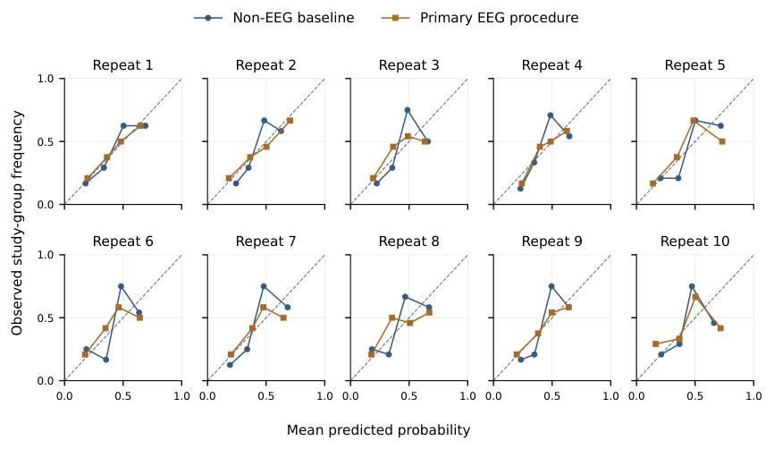
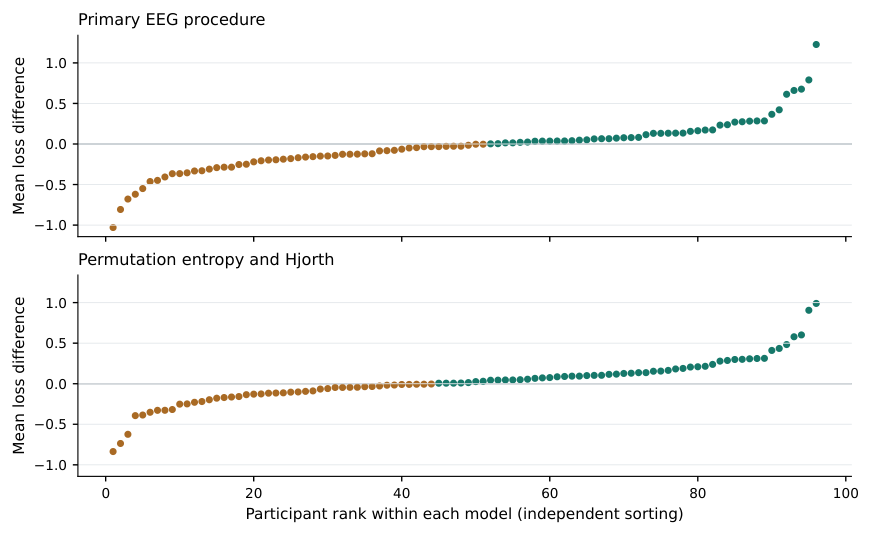
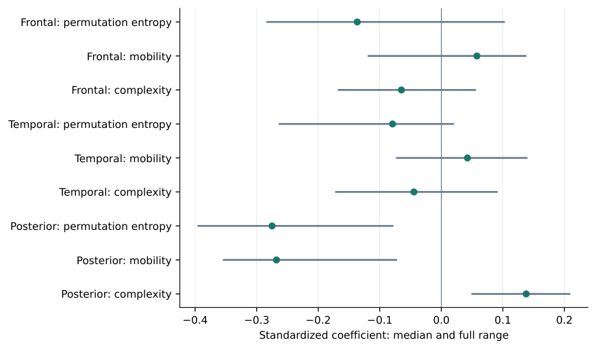
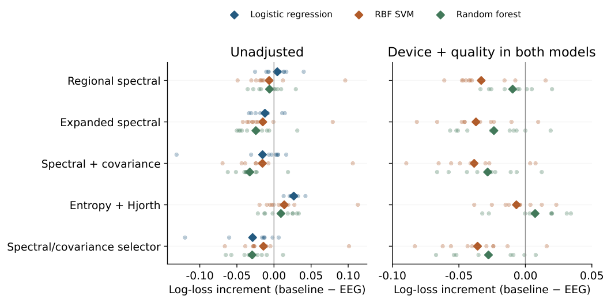
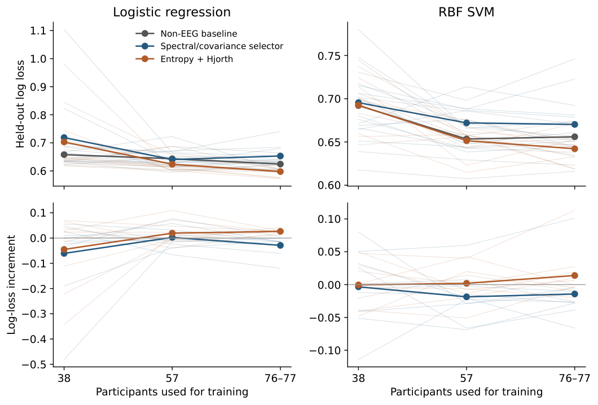
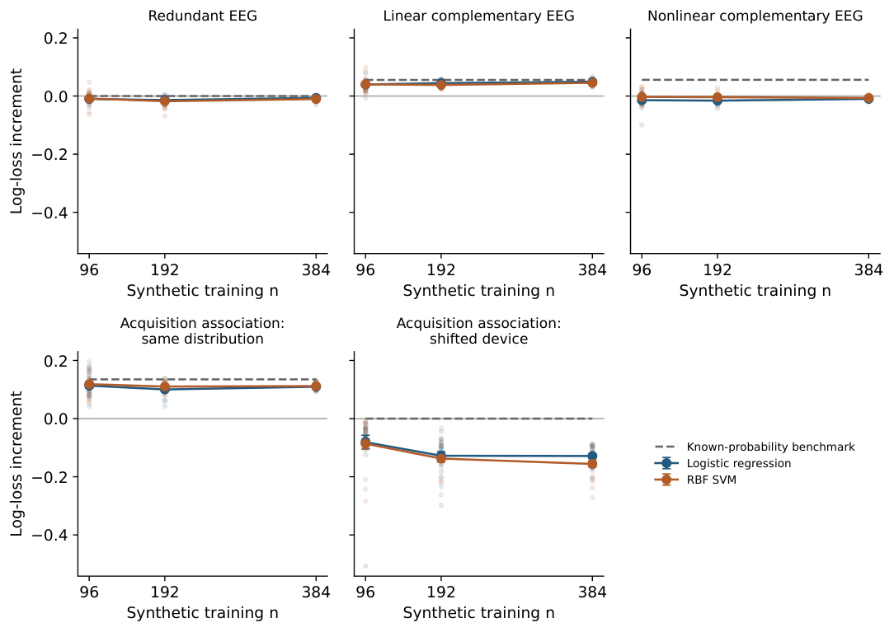
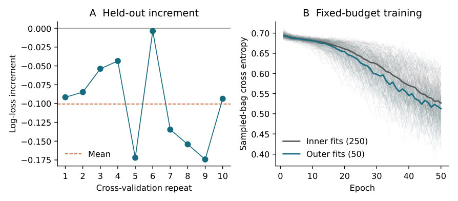

# Technical methods and complete numerical results

Companion to *Incremental Predictive Utility of EEG Representations Beyond Behavioral and Object-Gaze Measures in Pediatric ADHD*.

This note collects implementation details, complete comparison families, and diagnostic figures supporting the article. The journal supplement retains participant eligibility, the interpretation-critical methods and results, and the limits of inference. This reorganization changes no fitted model, recorded prediction, feature matrix, or numerical result. All tables and plots below derive from the existing analyses; no additional analyses were undertaken for this editorial revision.

**Scope and archival status.** This documentation update is dated 3 November 2026. The original and earlier exploratory computations are archived in [computational companion 1.2.1](https://doi.org/10.5281/zenodo.23864656). The later age, bandwidth, and prior-odds controls are supplied in a separate `targeted_controls_addendum.zip`; they and this note are not included in that archived version. The original preregistration, subsequent pre-fit exploratory plans, archived software versions, and present documentation are separate records. This note does not assign a new software version or DOI.

The primary comparison predicts recorded study-group membership. Positive increments favor EEG: baseline minus augmented log loss or Brier score, and augmented minus baseline AUROC. Unless stated otherwise, repeated pediatric analyses concern the same 96 participants and ten dependent cross-validation repeats. Later analyses retain their exploratory status.

Technical tables and figures have their own **T** numbering. References to **S** sections refer to the condensed journal supplement. Figures reproduced here retain their original plotted values. Exact table source files and figure PDFs accompany the readable tables and PNG previews in `technical_assets/`.

## Navigation

- [Measurement definitions and preprocessing](#measurement-summaries-and-eeg-preprocessing)
- [Representation formulas and dimensions](#eeg-representations-and-identifier-crosswalk)
- [Complete primary and supporting results](#primary-and-supporting-results)
- [Acquisition, components, and phase controls](#acquisition-components-and-selection-without-eeg)
- [Model-family comparisons and learning curves](#model-family-sensitivity-and-learning-curves)
- [File map and reproduction](#file-map-and-reproduction)

## Measurement summaries and EEG preprocessing

### Non-EEG predictors

The demographic model used age and the unmodified 1/2-coded source sex/gender variable. The behavioral addition comprised mean work speed, total omissions, and total commissions across the four task blocks. Correct responses were unavailable in part of the release and were not used; `maxBots` was excluded prospectively. The game summary has no target-level timestamps.

Work speed was the arithmetic mean of the released block scores `velocidadTrabajoBloque1` through `velocidadTrabajoBloque4`; omissions and commissions were the sums of the corresponding `omisionBloque` and `comisionBloque` fields. We retained these source scores without reconstructing events or converting work speed to response time. A physical unit for the work-speed score was not established in the release documentation used here.

The object-gaze file contains relative time, object weight, and the observed object’s row and column. Its two predictors describe spatial sampling, rather than fixation duration, saccades, or pupil responses. If $`p_{rc}`$ is the proportion of observations in grid cell $`(r,c)`$, normalized location entropy is
``` math

H_{\mathrm{gaze}}=-\frac{\sum_{r,c}p_{rc}\log p_{rc}}{\log(47\times14)}.

```
For dispersion, grid coordinates are mapped to $`x=(c-1)/46`$ and $`y=(r-1)/13`$. The feature is the root mean squared Euclidean distance of these points from the participant’s observation centroid. Combining demographics, behavior, and object gaze gives seven baseline predictors.

### Acquisition and continuous preprocessing

The 14 channels, in order, were AF3, F7, F3, FC5, T7, P7, O1, O2, P8, T8, FC6, F4, F8, and AF4. The final cohort included 54 Epoc X and 42 Epoc+ recordings. Ninety-four were sampled natively at 128 Hz; two sampled at 256 Hz were downsampled to 128 Hz by polyphase resampling with a Kaiser window (parameter 5.0) and constant padding.

Nonfinite samples and device-interpolated intervals defined segment boundaries. Within otherwise valid runs, segments also ended at nonpositive timestamp differences or gaps exceeding $`\max(0.25,2.5/f_s)`$ seconds, where $`f_s`$ is the native sampling rate. Each valid segment received a zero-phase fourth-order Butterworth band-pass filter at 1–40 Hz, implemented in second-order sections. Filtering did not cross segment boundaries. No additional notch filter or independent component analysis was applied.

A channel was unusable if it contained a run of identical finite samples exceeding $`\lfloor5f_s\rfloor+1`$ samples, more than 5% nonfinite samples, or 1–40-Hz log power more than five within-recording robust median-absolute-deviation units from the channel median. More than two unusable channels excluded a recording. Otherwise, interpolation used fixed planar montage coordinates and inverse-distance-squared weights (the `MONTAGE_XY` array in `audit/stage1_blind_feature_extraction/run_stage1_extraction.py`), followed by common-average reference.

### Artifact rejection and spectral estimation

Candidate windows contained 256 samples (2 s), advanced in steps of 128 samples. Peak-to-peak values for rejection were calculated after linear detrending. The robust limit was the median plus eight times $`1.4826\,\mathrm{MAD}`$ across candidate channel-window peak-to-peak values within participant, or the median alone if the scale was zero. A window failed if any channel exceeded either this limit or 500 $`\mu`$V. Accepted windows retained their signal values before the detrending used for rejection.

Participants had to retain at least 120 s of clean data, half of the candidate windows, 12 usable measured channels before interpolation, and one usable channel in each regional group. The groups were frontal (AF3, F7, F3, FC5, FC6, F4, F8, AF4), temporal (T7, T8), and posterior (P7, O1, O2, P8). Retained recordings contained 156–334 accepted windows, with a median of 239.

Clean duration was the total length of the union of accepted window intervals within each processed segment, summed across segments: overlapping samples were counted once, and gaps between intervals contributed no time. Clean-window fraction was the number of accepted windows divided by the number of candidate windows. Supplementary Section S1 gives retained-duration and clean-fraction distributions by group and device.

Spectral features used Welch estimates with a Hann window, 256 samples per segment, no within-window overlap, constant detrending, density scaling, and mean aggregation. Frequency integrations included both endpoints: broadband 1–40 Hz, delta 1–3 Hz, theta 4–7 Hz, alpha 8–12 Hz, and beta 13–30 Hz. Trapezoidal integration used only frequency bins within each stated interval. The 3.5-, 7.5-, and 12.5-Hz bins and frequencies above 30 Hz contribute to broadband power but not to these band integrals; the band summaries are not an exhaustive partition of broadband power. Unless specified otherwise below, participant summaries were medians across accepted windows and then across channels within a region.

## EEG representations and identifier crosswalk

Table T1 links the method names used in the article to identifiers retained in the data and code. The primary library was cumulative: expanded spectral features included regional spectral features, and the covariance-augmented representation included the expanded features. The later families were each evaluated separately after the primary result was known.

#### Technical Table T1

| Identifier | Method name and composition | EEG | Total |
|:---|:---|---:|---:|
| M0 | Demographics | 0 | 2 |
| M1 | Demographics and task behavior | 0 | 5 |
| M2 | Non-EEG baseline: M1 plus object gaze | 0 | 7 |
| adaptive M3 | Primary EEG-augmented procedure; selects E0, E1, or E2 | varies | varies |
| E0 | Regional spectral features, added to M2 | 12 | 19 |
| E1 | Expanded spectral features: E0 plus topography, variability, spectral entropy | 35 | 42 |
| E2 | Expanded spectral and covariance features: E1 plus covariance components | 47 | 54 |
| E3 | Phase-lag connectivity, added to M2 | 9 | 16 |
| E4 | Permutation entropy and Hjorth features, added to M2 | 9 | 16 |
| E5 | Spectral-state features, added to M2 | 9 | 16 |

Method names, computational identifiers, and predictor dimensions.

EEG counts are final dimensions after any training-only reduction. E0–E2 form the preregistered library; E3–E5 are separate post-hoc families. Raw dimensions and transformations are specified below.

### Regional and expanded spectral features

For each channel, regional spectral features used the base-10 logarithm of median broadband power and median relative theta, alpha, and beta power. Relative power was band power divided by broadband power within each window. The broadband logarithm was applied after the window median within each channel and before the median across channels; relative band powers were not log-transformed in this representation. Regional medians gave four quantities in each of three regions, or 12 predictors.

Expanded spectral features retained these predictors and added three blocks. A topographic block contained five channel-level quantities–log broadband and log relative delta, theta, alpha, and beta power–for 70 raw variables. Training-partition standardization and full-SVD principal component analysis (PCA) retained 15 components. A variability block contained type-7 interquartile ranges across windows for five spectral quantities in each region (15 raw variables), standardized and reduced to five components within training data. Three normalized Shannon entropies of the regional median 1–40-Hz spectra entered directly. The combined EEG representation therefore had 35 dimensions.

### Expanded spectral and covariance features

The covariance representation retained all expanded spectral features. After broadband preprocessing and common-average reference, continuous segments were separately filtered in theta, alpha, and beta using zero-phase fourth-order Butterworth filters. The same accepted window indices were reused without another rejection step. Each band-filtered window was centered by its channel means and projected to a fixed 13-dimensional orthonormal Helmert contrast basis.

The covariance regularization used the shrinkage-coefficient form implemented by scikit-learn for oracle-approximating shrinkage (Chen et al. 2010). For sample covariance $`S`$ with denominator $`n-1`$, $`n`$ window samples, and $`p=13`$ coordinates, let $`\mu=\operatorname{tr}(S)/p`$ and $`a=p^{-2}\sum_{ij}S_{ij}^{2}`$. The shrinkage weight and regularized covariance were
``` math

\lambda=\operatorname{clip}_{[0,1]}\left\{\frac{a+\mu^2}{(n+1)(a-\mu^2/p)}\right\},
\qquad S_{\lambda}=(1-\lambda)S+\lambda\mu I.

```
The weight was one for a nonpositive or nonfinite denominator. This implementation omits the $`2/p`$ terms in the original OAS expression; it should not be replaced by that expression when reproducing the representation. Eigenvalues were floored at $`10^{-6}`$ times the mean eigenvalue and the matrix was normalized to unit trace. A log-Euclidean mean combined windows within participant, followed by unit-trace normalization (Arsigny et al. 2007).

For each band, the training participants’ covariance matrices $`C_i`$ defined the reference
``` math

A=\exp\!\left(\frac{1}{n_{\mathrm{tr}}}\sum_{i\in\mathrm{train}}\log C_i\right),
\qquad G=A/\operatorname{tr}(A).

```
A participant covariance $`C`$ was mapped to $`T=\log(G^{-1/2}CG^{-1/2})`$. The lower triangle gave 91 coordinates, with off-diagonal entries multiplied by $`\sqrt{2}`$. PCA centered these coordinates without coordinate-wise variance scaling and retained four components per band. The 12 covariance components increased the EEG dimension to 47. The complete regression design was subsequently standardized. References and PCA were fitted only in the applicable training partition.

### Phase-lag connectivity

Each accepted window was multiplied by four discrete prolate spheroidal sequence tapers, with time-bandwidth product 2.5, periodic convention, and $`L_2`$ normalization. Fourier coefficients at 128 Hz gave 0.5-Hz bins. For one channel pair at a fixed frequency, $`I_j`$ denotes the imaginary cross-spectrum, with $`j`$ indexing all accepted-window–taper combinations. Debiased squared weighted phase-lag index was computed as (Vinck et al. 2011)
``` math

\operatorname{dwPLI}^{2}=\frac{(\sum_j I_j)^2-\sum_j I_j^2}{(\sum_j |I_j|)^2-\sum_j I_j^2}.

```
Negative estimates were retained. For each of the 91 unordered channel pairs, the median of frequency-specific estimates was taken within theta, alpha, and beta, giving 273 raw variables. Training-only standardization and PCA retained three components per band. These nine predictors describe sensor-level phase dependence, not source-localized anatomical connectivity.

### Permutation entropy and Hjorth features

Each accepted channel-window was normalized by its median and $`1.4826`$ times its median absolute deviation. Permutation entropy used embedding dimension $`m=5`$ and delay $`\tau=1`$ (Bandt and Pompe 2002). Stable sorting assigned each length-five vector to an ordinal pattern; ties retained temporal order. For pattern probabilities $`p_k`$ over the $`5!=120`$ possible patterns,
``` math

H_{\mathrm{perm}}=-\frac{\sum_k p_k\log p_k}{\log(120)}.

```
For normalized signal $`x`$, our implementation used finite-difference versions of the variance-based Hjorth descriptors (Hjorth 1970), with mobility and complexity defined as
``` math

M(x)=\sqrt{\frac{\operatorname{var}(\Delta x)}{\operatorname{var}(x)}},
\qquad C(x)=\frac{M(\Delta x)}{M(x)}.

```
Variances in the Hjorth formulas used denominator $`n`$ for the signal and the respective lengths of its first and second finite differences (`ddof=0`). Each measure was median-aggregated across accepted windows within channel, then across channels within each region. The nine regional features entered directly, without PCA.

### Spectral-state features

Within continuous accepted segments, 128-sample frames (1 s) advanced by 32 samples (0.25 s), with each frame lying wholly within accepted 2-s windows. A one-sided Hann-window periodogram used constant detrending, density scaling, and 128 Fourier points. Relative theta, alpha, and beta energy, divided by 1–40-Hz energy, was log-transformed and median-aggregated across channels within each region.

For each region-band trajectory $`v_t`$, robust within-participant normalization gave $`z_t=[v_t-\operatorname{median}(v)]/[1.4826\,\operatorname{MAD}(v)]`$. A high state had $`z_t>1`$. Features were high-state occupancy, median high-state duration, and switching rate. A run of $`q`$ frames lasted $`1+0.25(q-1)`$ s; no high run gave duration zero. Switching rate counted high/low transitions per valid adjacency time, multiplied by 60. Runs and adjacencies did not cross segment or invalid-frame gaps. The 27 variables were standardized within training data and reduced by band-specific PCA to three components per band.

The variables were grouped by frequency band: theta, alpha, and beta each contributed nine variables, comprising three summaries in each of three regions. The resulting nine principal components were added to the non-EEG baseline in this post-hoc comparison.

## Model fitting, selection, and outcome summaries

The original analyses used L2 logistic regression with an unpenalized intercept, no class weighting, and no outcome-guided feature screening. The solver was `lbfgs`, with tolerance $`10^{-6}`$ and at most 1,000 iterations; the identical retry allowed 10,000 iterations but was not needed for the reported predictive fits. The inverse regularization grid was $`C\in\{0.01,0.1,1,10,100\}`$. Ten repeats of stratified five-fold outer cross-validation each contained five-fold inner cross-validation. Participants stayed intact; every participant received one outer-test prediction per repeat. Paired models used identical partitions.

The non-EEG baseline selected $`C`$ by participant-pooled inner-validation log loss. The primary EEG procedure jointly selected the representation and $`C`$ from 15 combinations. Inner scores were rounded to 12 decimal places before selection; ties favored regional spectral, then expanded spectral, then expanded spectral and covariance features, followed by smaller $`C`$. Omitting EEG was not an option in this primary library. The separate fixed-representation analyses tuned $`C`$ within each family. Later families were not selected against one another.

Every transformation learned across participants was fitted inside the relevant training partition. The selected complete procedure was refitted on the outer-training set and applied to held-out participants. All final inputs were finite, so no missing-value replacement was required. Implementation-level safeguards, solver settings, seeds, and environment versions belong to the accompanying reproducibility specification; they do not change the feature definitions given here.

For participant $`i`$ and repeat $`r`$, the primary paired difference was
``` math

d_{ir}=L(y_i,p^{\mathrm{baseline}}_{ir})-L(y_i,p^{\mathrm{EEG}}_{ir}),
\qquad \Delta_{\mathrm{LL}}=\operatorname{mean}_{i,r}(d_{ir}).

```
Binary log loss clipped probabilities to $`[10^{-8},1-10^{-8}]`$. Within each repeat, held-out predictions were pooled across participants to calculate log loss, AUROC, and Brier score. The ten repeat-level estimates were then averaged. Positive AUROC differences mean evaluated minus baseline AUROC; positive Brier differences mean baseline minus evaluated Brier score. All differences therefore favor the evaluated model in the same direction.

The primary comparison and individual initial-library representations retain their preregistered roles, with the diagnosis-status analysis as a separate sensitivity. The non-EEG sequence is descriptive. Additional representations and all later explanatory analyses are post hoc. No primary $`p`$ value or confirmatory confidence interval was specified, and no later test treated repeats as independent samples. The repeated partitions characterize variation in the evaluation of this cohort.

## Primary and supporting results

### Complete performance and non-EEG comparisons

Table T2 gives absolute performance and matched differences. Task behavior accounted for most of the observed improvement from demographics to the non-EEG baseline. Object-gaze summaries added little further log-loss improvement, with unfavorable secondary-metric changes. The primary EEG procedure was unfavorable on average, as were the expanded spectral models. Regional spectral features had a small favorable log-loss difference without corresponding AUROC or Brier improvement.

The inner procedure selected regional spectral features in 22 of 50 outer fits and expanded spectral and covariance features in 28; expanded spectral features alone were never selected. The baseline selected $`C=0.1`$ in 36 fits and $`C=1`$ in 14. Every selected regional spectral model used $`C=0.1`$; covariance-augmented selections used $`C=0.01`$, $`0.1`$, and $`1`$ in 16, 11, and one fit, respectively. These frequencies describe correlated fits, rather than an independent ranking of representations. Full-precision repeat results are in the computational package (the file map below).

Across the ten repeats of the preregistered primary comparison (the non-EEG baseline versus the training-selected spectral/covariance procedure), $`\Delta_{\mathrm{LL}}`$ had median $`-0.0152`$, interquartile range $`[-0.0283,-0.0128]`$, and range $`[-0.1200,+0.0063]`$; one of ten repeats favored EEG. Quartiles use linear interpolation (type 7). These are descriptive summaries of dependent partitions of the same participants, not independent replications or an uncertainty interval. The ten individual values are supplied in `supplementary_data/PRIMARY_REPEAT_SUMMARY.csv` and plotted in main Figure 1.

#### Technical Table T2

| Model | LL | $`\Delta_{\mathrm{LL}}`$ | AUROC | $`\Delta_{\mathrm{AUROC}}`$ | Brier | $`\Delta_{\mathrm{Brier}}`$ |
|:---|---:|---:|---:|---:|---:|---:|
| Demographics | 0.6461 | – | 0.6692 | – | 0.2264 | – |
| Demographics and task behavior | 0.6256 | – | 0.7161 | – | 0.2146 | – |
| Non-EEG baseline | 0.6244 | – | 0.7139 | – | 0.2157 | – |
|  |  |  |  |  |  |  |
| Primary EEG-augmented procedure | 0.6532 | $`-0.0288`$ | 0.6662 | $`-0.0478`$ | 0.2289 | $`-0.0131`$ |
|  |  |  |  |  |  |  |
| Regional spectral features | 0.6199 | $`+0.0045`$ | 0.7026 | $`-0.0113`$ | 0.2167 | $`-0.0009`$ |
| Expanded spectral features | 0.6366 | $`-0.0122`$ | 0.6867 | $`-0.0272`$ | 0.2237 | $`-0.0079`$ |
| Expanded spectral and covariance features | 0.6398 | $`-0.0154`$ | 0.6891 | $`-0.0248`$ | 0.2228 | $`-0.0070`$ |
|  |  |  |  |  |  |  |
| Phase-lag connectivity | 0.6117 | $`+0.0127`$ | 0.7170 | $`+0.0031`$ | 0.2122 | $`+0.0035`$ |
| Permutation entropy and Hjorth features | 0.5977 | $`+0.0267`$ | 0.7291 | $`+0.0152`$ | 0.2080 | $`+0.0077`$ |
| Spectral-state features | 0.6337 | $`-0.0093`$ | 0.6883 | $`-0.0256`$ | 0.2208 | $`-0.0051`$ |
|  |  |  |  |  |  |  |
| Add task behavior | – | $`+0.0205`$ | – | $`+0.0469`$ | – | $`+0.0118`$ |
| Add object gaze | – | $`+0.0012`$ | – | $`-0.0021`$ | – | $`-0.0012`$ |

Complete mean performance and supporting non-EEG comparisons.

<div class="minipage">

LL: log loss. EEG differences use the non-EEG baseline. Positive differences favor the evaluated addition; repeat estimates are descriptive. Expanded spectral models include the preceding EEG representation. Full precision and repeat-specific estimates are supplied as CSV files.

</div>

### Diagnosis-status sensitivity

Changing the target and eligible subset did not reverse the mean direction of the primary comparison (Table T3). The analysis included 84 participants with exact diagnosis-status values and newly stratified folds. It does not resolve the disagreement between that field and study group. Its repeat-level results are included in the same package.

#### Technical Table T3

| Model or comparison   |    Log loss |       AUROC |       Brier |
|:----------------------|------------:|------------:|------------:|
| Non-EEG baseline      |      0.5971 |      0.7059 |      0.2037 |
| Primary EEG procedure |      0.6125 |      0.6877 |      0.2051 |
| EEG increment         | $`-0.0155`$ | $`-0.0183`$ | $`-0.0015`$ |

Diagnosis-status sensitivity: mean results in the 84-participant subset.

<div class="minipage">

The last row gives oriented differences, not absolute performance. The target is exact diagnosed yes/no, with new stratified folds; these results are not an independent replication.

</div>

The historical archive contains repeat-level diagnosis-sensitivity metrics but not participant predictions or selected regularization values. A new run can generate those records, but their identity cannot be checked against an absent historical reference.

### Calibration diagnostics

Descriptive scalar logistic regressions used each repeat’s baseline and primary EEG out-of-fold probabilities to estimate calibration intercept, slope, and calibration-in-the-large (CITL). The original BFGS implementation reported precision loss in five of ten repeats for each model. We subsequently solved the same unpenalized calibration likelihood by damped Newton iteration, without changing the predictive models or their held-out probabilities. CITL remained a separate intercept-only offset fit.

Table T4 reports this post-hoc numerical follow-up and identifies the original failed fits. All 20 solutions met the gradient and positive-Hessian checks and agreed with an independently initialized solution of the score equations; estimates available from the original fits agreed within $`10^{-7}`$. The original estimates and failure records remain in `audit/preregistered_analysis/CALIBRATION_RESULTS.csv`. Figure T1 retains the original reliability bins.

#### Technical Table T4

<table>
<caption>Scalar calibration estimates from the numerical follow-up.</caption>
<thead>
<tr>
<th style="text-align: right;"></th>
<th colspan="3" style="text-align: center;">Non-EEG baseline</th>
<th colspan="3" style="text-align: center;">Primary EEG procedure</th>
</tr>
</thead>
<tbody>
<tr>
<td style="text-align: right;"><span>2-4</span>(lr)<span>5-7</span> Repeat</td>
<td style="text-align: right;">Intercept</td>
<td style="text-align: right;">Slope</td>
<td style="text-align: right;">CITL</td>
<td style="text-align: right;">Intercept</td>
<td style="text-align: right;">Slope</td>
<td style="text-align: right;">CITL</td>
</tr>
<tr>
<td style="text-align: right;">1</td>
<td style="text-align: right;"><span class="math inline">−0.0388</span></td>
<td style="text-align: right;">0.8443<span class="math inline"><sup>†</sup></span></td>
<td style="text-align: right;"><span class="math inline">+0.0001</span></td>
<td style="text-align: right;"><span class="math inline">−0.0218</span></td>
<td style="text-align: right;">0.8331<span class="math inline"><sup>†</sup></span></td>
<td style="text-align: right;"><span class="math inline">+0.0246</span></td>
</tr>
<tr>
<td style="text-align: right;">2</td>
<td style="text-align: right;"><span class="math inline">+0.1074</span></td>
<td style="text-align: right;">1.3620<span class="math inline"><sup>†</sup></span></td>
<td style="text-align: right;"><span class="math inline">+0.0054</span></td>
<td style="text-align: right;"><span class="math inline">−0.0658</span></td>
<td style="text-align: right;">0.9554<span class="math inline"><sup>†</sup></span></td>
<td style="text-align: right;"><span class="math inline">−0.0573</span></td>
</tr>
<tr>
<td style="text-align: right;">3</td>
<td style="text-align: right;"><span class="math inline">−0.0434</span></td>
<td style="text-align: right;">0.9106<span class="math inline"><sup>†</sup></span></td>
<td style="text-align: right;"><span class="math inline">−0.0197</span></td>
<td style="text-align: right;"><span class="math inline">−0.0352</span></td>
<td style="text-align: right;">0.7736</td>
<td style="text-align: right;"><span class="math inline">+0.0327</span></td>
</tr>
<tr>
<td style="text-align: right;">4</td>
<td style="text-align: right;"><span class="math inline">−0.0193</span></td>
<td style="text-align: right;">0.9387</td>
<td style="text-align: right;"><span class="math inline">−0.0024</span></td>
<td style="text-align: right;"><span class="math inline">−0.0681</span></td>
<td style="text-align: right;">0.9037</td>
<td style="text-align: right;"><span class="math inline">−0.0469</span></td>
</tr>
<tr>
<td style="text-align: right;">5</td>
<td style="text-align: right;"><span class="math inline">−0.1212</span></td>
<td style="text-align: right;">0.8366<span class="math inline"><sup>†</sup></span></td>
<td style="text-align: right;"><span class="math inline">−0.0895</span></td>
<td style="text-align: right;"><span class="math inline">−0.1917</span></td>
<td style="text-align: right;">0.2806<span class="math inline"><sup>†</sup></span></td>
<td style="text-align: right;"><span class="math inline">+0.0083</span></td>
</tr>
<tr>
<td style="text-align: right;">6</td>
<td style="text-align: right;"><span class="math inline">−0.0465</span></td>
<td style="text-align: right;">0.6563</td>
<td style="text-align: right;"><span class="math inline">+0.0577</span></td>
<td style="text-align: right;"><span class="math inline">−0.0354</span></td>
<td style="text-align: right;">0.6446</td>
<td style="text-align: right;"><span class="math inline">+0.0948</span></td>
</tr>
<tr>
<td style="text-align: right;">7</td>
<td style="text-align: right;"><span class="math inline">+0.0015</span></td>
<td style="text-align: right;">0.9466</td>
<td style="text-align: right;"><span class="math inline">+0.0176</span></td>
<td style="text-align: right;"><span class="math inline">−0.0432</span></td>
<td style="text-align: right;">0.8353<span class="math inline"><sup>†</sup></span></td>
<td style="text-align: right;"><span class="math inline">+0.0009</span></td>
</tr>
<tr>
<td style="text-align: right;">8</td>
<td style="text-align: right;"><span class="math inline">+0.0093</span></td>
<td style="text-align: right;">0.8137</td>
<td style="text-align: right;"><span class="math inline">+0.0741</span></td>
<td style="text-align: right;"><span class="math inline">−0.1454</span></td>
<td style="text-align: right;">0.4602<span class="math inline"><sup>†</sup></span></td>
<td style="text-align: right;"><span class="math inline">−0.0062</span></td>
</tr>
<tr>
<td style="text-align: right;">9</td>
<td style="text-align: right;"><span class="math inline">+0.0489</span></td>
<td style="text-align: right;">1.2463</td>
<td style="text-align: right;"><span class="math inline">−0.0129</span></td>
<td style="text-align: right;"><span class="math inline">−0.0374</span></td>
<td style="text-align: right;">0.8788</td>
<td style="text-align: right;"><span class="math inline">−0.0093</span></td>
</tr>
<tr>
<td style="text-align: right;">10</td>
<td style="text-align: right;"><span class="math inline">−0.1259</span></td>
<td style="text-align: right;">0.5629<span class="math inline"><sup>†</sup></span></td>
<td style="text-align: right;"><span class="math inline">−0.0026</span></td>
<td style="text-align: right;"><span class="math inline">−0.1639</span></td>
<td style="text-align: right;">0.4750</td>
<td style="text-align: right;"><span class="math inline">−0.0528</span></td>
</tr>
</tbody>
</table>

<div class="minipage">

CITL: calibration-in-the-large. Repeat numbers start at one here and at zero in the data. $`\dagger`$ marks an original BFGS precision-loss failure. Values are the post-hoc Newton solutions of the same unpenalized calibration model; the original estimates and failure records are retained in the data package. The predictive probabilities are unchanged.

</div>

#### Technical Figure T1

<figure data-latex-placement="!htbp">

<figcaption>Technical Figure T1. Primary-model reliability diagrams. Panels show the four recorded bins within each repeat; the diagonal indicates equal mean predicted probability and observed study-group frequency. Table T4 gives the numerical follow-up of the scalar calibration fits and marks the original failures. Curves are descriptive and have no uncertainty intervals. Displayed repeat numbers are one greater than the zero-based indices in the data.</figcaption>
</figure>

## Acquisition, components, and selection without EEG

These analyses were specified after the primary and additional-representation results were known. They retained the same 96 participants, 50 outer partitions, and 250 inner partitions, with each modified model separately tuned. Table T5 includes all 35 comparisons, grouping reference results, acquisition adjustments, component models, and direct contrasts. Complete repeat estimates are in the computational package (the file map below).

### Device and quality adjustment

Device adjustment appended an Epoc+ indicator (Epoc+ = 1, Epoc X = 0) to both members of each comparison. Device-plus-quality adjustment also appended clean-window fraction and interpolated-channel count. The quality measures require EEG acquisition: this baseline conditions on EEG-derived quality and is not available from non-EEG measurements alone. Baseline and augmented models were independently tuned using the same covariates and partitions.

The entropy and Hjorth increment decreased under device adjustment and decreased further when quality was included. Combined adjustment left a favorable mean log-loss difference but unfavorable AUROC and Brier differences. Both adjusted primary procedures, and all adjusted fixed representations from the primary library, were unfavorable on average. The result files include device-by-group loss and quality summaries; they summarize held-out predictions from models fitted across devices, rather than new models trained within subgroups. These adjustments do not constitute unseen-device validation or identify a causal artifact contribution.

### Feature blocks and spectral controls

Six entropy and Hjorth variants retained entropy, mobility, or complexity alone (three regional features) or omitted one block (six features). Each variant was refitted and retuned. Entropy alone retained a favorable increment, and removing entropy reduced the full model’s increment. Removing either Hjorth block increased it. These differences are not additive shares of predictive value because the remaining coefficients and regularization also change.

Two spectral controls matched the full model’s nine EEG dimensions. The direct control used relative theta, alpha, and beta power in each region, omitting broadband power. The PCA control standardized all 12 regional spectral features and retained nine full-SVD principal components within training data, followed by standardization of the complete design. Both yielded smaller log-loss increments with mixed secondary metrics (main Figure 3). Matching dimension under these specifications does not isolate a causal effect of feature count.

### Allowing the selector to omit EEG

The policy chose among the non-EEG baseline and the three initial EEG representations across the five regularization values. It reused the inner scores and outer predictions corresponding to each selected configuration. Ties favored the baseline, then regional spectral, expanded spectral, and covariance-augmented features, followed by smaller $`C`$. The additional representations were not candidates.

The policy selected the baseline in 20 of 50 fits, regional spectral features in ten, and expanded spectral and covariance features in 20. Its mean log loss was 0.6686, worse than both the baseline and the primary EEG procedure. It still predicted every participant: omitting EEG is model selection, not withholding a prediction. Table T5 gives both contrasts.

#### Technical Table T5

<table style="width:47%;">
<caption>All post-hoc explanatory comparisons and reference results.</caption>
<colgroup>
<col style="width: 47%" />
<col />
<col />
<col />
<col />
</colgroup>
<thead>
<tr>
<th style="text-align: left;">Evaluated model or addition</th>
<th style="text-align: right;"><span class="math inline"><em>Δ</em><sub>LL</sub></span></th>
<th style="text-align: right;"><span class="math inline"><em>Δ</em><sub>AUROC</sub></span></th>
<th style="text-align: right;"><span class="math inline"><em>Δ</em><sub>Brier</sub></span></th>
<th style="text-align: right;"><span class="math inline"><em>R</em><sub>+</sub></span></th>
</tr>
</thead>
<tbody>
<tr>
<td colspan="5" style="text-align: left;">Table  (continued)</td>
</tr>
<tr>
<td style="text-align: left;">Evaluated model or addition</td>
<td style="text-align: right;"><span class="math inline"><em>Δ</em><sub>LL</sub></span></td>
<td style="text-align: right;"><span class="math inline"><em>Δ</em><sub>AUROC</sub></span></td>
<td style="text-align: right;"><span class="math inline"><em>Δ</em><sub>Brier</sub></span></td>
<td style="text-align: right;"><span class="math inline"><em>R</em><sub>+</sub></span></td>
</tr>
<tr>
<td colspan="5" style="text-align: right;">Continued on next page</td>
</tr>
<tr>
<td style="text-align: left;"></td>
<td style="text-align: right;"></td>
<td style="text-align: right;"></td>
<td style="text-align: right;"></td>
<td style="text-align: right;"></td>
</tr>
<tr>
<td style="text-align: left;">* Primary EEG-augmented procedure</td>
<td style="text-align: right;"><span class="math inline">−0.0288</span></td>
<td style="text-align: right;"><span class="math inline">−0.0478</span></td>
<td style="text-align: right;"><span class="math inline">−0.0131</span></td>
<td style="text-align: right;">1</td>
</tr>
<tr>
<td style="text-align: left;">* Regional spectral features</td>
<td style="text-align: right;"><span class="math inline">+0.0045</span></td>
<td style="text-align: right;"><span class="math inline">−0.0113</span></td>
<td style="text-align: right;"><span class="math inline">−0.0009</span></td>
<td style="text-align: right;">6</td>
</tr>
<tr>
<td style="text-align: left;">* Expanded spectral features</td>
<td style="text-align: right;"><span class="math inline">−0.0122</span></td>
<td style="text-align: right;"><span class="math inline">−0.0272</span></td>
<td style="text-align: right;"><span class="math inline">−0.0079</span></td>
<td style="text-align: right;">2</td>
</tr>
<tr>
<td style="text-align: left;">* Expanded spectral and covariance features</td>
<td style="text-align: right;"><span class="math inline">−0.0154</span></td>
<td style="text-align: right;"><span class="math inline">−0.0248</span></td>
<td style="text-align: right;"><span class="math inline">−0.0070</span></td>
<td style="text-align: right;">5</td>
</tr>
<tr>
<td style="text-align: left;">* Permutation entropy and Hjorth features</td>
<td style="text-align: right;"><span class="math inline">+0.0267</span></td>
<td style="text-align: right;"><span class="math inline">+0.0152</span></td>
<td style="text-align: right;"><span class="math inline">+0.0077</span></td>
<td style="text-align: right;">10</td>
</tr>
<tr>
<td style="text-align: left;"></td>
<td style="text-align: right;"></td>
<td style="text-align: right;"></td>
<td style="text-align: right;"></td>
<td style="text-align: right;"></td>
</tr>
<tr>
<td style="text-align: left;">* Add device indicator</td>
<td style="text-align: right;"><span class="math inline">+0.0150</span></td>
<td style="text-align: right;"><span class="math inline">+0.0230</span></td>
<td style="text-align: right;"><span class="math inline">+0.0072</span></td>
<td style="text-align: right;">9</td>
</tr>
<tr>
<td style="text-align: left;">* Add device and EEG-quality measures</td>
<td style="text-align: right;"><span class="math inline">+0.0064</span></td>
<td style="text-align: right;"><span class="math inline">+0.0088</span></td>
<td style="text-align: right;"><span class="math inline">+0.0038</span></td>
<td style="text-align: right;">7</td>
</tr>
<tr>
<td style="text-align: left;"></td>
<td style="text-align: right;"></td>
<td style="text-align: right;"></td>
<td style="text-align: right;"></td>
<td style="text-align: right;"></td>
</tr>
<tr>
<td style="text-align: left;">* Regional spectral features</td>
<td style="text-align: right;"><span class="math inline">−0.0027</span></td>
<td style="text-align: right;"><span class="math inline">−0.0260</span></td>
<td style="text-align: right;"><span class="math inline">−0.0047</span></td>
<td style="text-align: right;">3</td>
</tr>
<tr>
<td style="text-align: left;">* Expanded spectral features</td>
<td style="text-align: right;"><span class="math inline">−0.0235</span></td>
<td style="text-align: right;"><span class="math inline">−0.0416</span></td>
<td style="text-align: right;"><span class="math inline">−0.0129</span></td>
<td style="text-align: right;">1</td>
</tr>
<tr>
<td style="text-align: left;">* Expanded spectral and covariance features</td>
<td style="text-align: right;"><span class="math inline">−0.0210</span></td>
<td style="text-align: right;"><span class="math inline">−0.0396</span></td>
<td style="text-align: right;"><span class="math inline">−0.0121</span></td>
<td style="text-align: right;">1</td>
</tr>
<tr>
<td style="text-align: left;">* Permutation entropy and Hjorth features</td>
<td style="text-align: right;"><span class="math inline">+0.0204</span></td>
<td style="text-align: right;"><span class="math inline">+0.0050</span></td>
<td style="text-align: right;"><span class="math inline">+0.0043</span></td>
<td style="text-align: right;">9</td>
</tr>
<tr>
<td style="text-align: left;">* Primary EEG-augmented procedure</td>
<td style="text-align: right;"><span class="math inline">−0.0208</span></td>
<td style="text-align: right;"><span class="math inline">−0.0453</span></td>
<td style="text-align: right;"><span class="math inline">−0.0123</span></td>
<td style="text-align: right;">1</td>
</tr>
<tr>
<td style="text-align: left;"></td>
<td style="text-align: right;"></td>
<td style="text-align: right;"></td>
<td style="text-align: right;"></td>
<td style="text-align: right;"></td>
</tr>
<tr>
<td style="text-align: left;">* Regional spectral features</td>
<td style="text-align: right;"><span class="math inline">−0.0127</span></td>
<td style="text-align: right;"><span class="math inline">−0.0353</span></td>
<td style="text-align: right;"><span class="math inline">−0.0088</span></td>
<td style="text-align: right;">2</td>
</tr>
<tr>
<td style="text-align: left;">* Expanded spectral features</td>
<td style="text-align: right;"><span class="math inline">−0.0155</span></td>
<td style="text-align: right;"><span class="math inline">−0.0321</span></td>
<td style="text-align: right;"><span class="math inline">−0.0100</span></td>
<td style="text-align: right;">1</td>
</tr>
<tr>
<td style="text-align: left;">* Expanded spectral and covariance features</td>
<td style="text-align: right;"><span class="math inline">−0.0142</span></td>
<td style="text-align: right;"><span class="math inline">−0.0314</span></td>
<td style="text-align: right;"><span class="math inline">−0.0093</span></td>
<td style="text-align: right;">2</td>
</tr>
<tr>
<td style="text-align: left;">* Permutation entropy and Hjorth features</td>
<td style="text-align: right;"><span class="math inline">+0.0071</span></td>
<td style="text-align: right;"><span class="math inline">−0.0078</span></td>
<td style="text-align: right;"><span class="math inline">−0.0011</span></td>
<td style="text-align: right;">6</td>
</tr>
<tr>
<td style="text-align: left;">* Primary EEG-augmented procedure</td>
<td style="text-align: right;"><span class="math inline">−0.0258</span></td>
<td style="text-align: right;"><span class="math inline">−0.0507</span></td>
<td style="text-align: right;"><span class="math inline">−0.0145</span></td>
<td style="text-align: right;">1</td>
</tr>
<tr>
<td style="text-align: left;"></td>
<td style="text-align: right;"></td>
<td style="text-align: right;"></td>
<td style="text-align: right;"></td>
<td style="text-align: right;"></td>
</tr>
<tr>
<td style="text-align: left;">* Permutation entropy only</td>
<td style="text-align: right;"><span class="math inline">+0.0301</span></td>
<td style="text-align: right;"><span class="math inline">+0.0269</span></td>
<td style="text-align: right;"><span class="math inline">+0.0113</span></td>
<td style="text-align: right;">10</td>
</tr>
<tr>
<td style="text-align: left;">* Hjorth mobility only</td>
<td style="text-align: right;"><span class="math inline">+0.0176</span></td>
<td style="text-align: right;"><span class="math inline">+0.0080</span></td>
<td style="text-align: right;"><span class="math inline">+0.0060</span></td>
<td style="text-align: right;">8</td>
</tr>
<tr>
<td style="text-align: left;">* Hjorth complexity only</td>
<td style="text-align: right;"><span class="math inline">+0.0108</span></td>
<td style="text-align: right;"><span class="math inline">−0.0067</span></td>
<td style="text-align: right;"><span class="math inline">+0.0020</span></td>
<td style="text-align: right;">8</td>
</tr>
<tr>
<td style="text-align: left;">* Without permutation entropy</td>
<td style="text-align: right;"><span class="math inline">+0.0180</span></td>
<td style="text-align: right;"><span class="math inline">+0.0026</span></td>
<td style="text-align: right;"><span class="math inline">+0.0046</span></td>
<td style="text-align: right;">9</td>
</tr>
<tr>
<td style="text-align: left;">* Without Hjorth mobility</td>
<td style="text-align: right;"><span class="math inline">+0.0291</span></td>
<td style="text-align: right;"><span class="math inline">+0.0209</span></td>
<td style="text-align: right;"><span class="math inline">+0.0092</span></td>
<td style="text-align: right;">10</td>
</tr>
<tr>
<td style="text-align: left;">* Without Hjorth complexity</td>
<td style="text-align: right;"><span class="math inline">+0.0294</span></td>
<td style="text-align: right;"><span class="math inline">+0.0223</span></td>
<td style="text-align: right;"><span class="math inline">+0.0097</span></td>
<td style="text-align: right;">10</td>
</tr>
<tr>
<td style="text-align: left;">* Regional relative power (nine features)</td>
<td style="text-align: right;"><span class="math inline">+0.0043</span></td>
<td style="text-align: right;"><span class="math inline">−0.0008</span></td>
<td style="text-align: right;"><span class="math inline">+0.0002</span></td>
<td style="text-align: right;">6</td>
</tr>
<tr>
<td style="text-align: left;">* Regional spectral PCA (nine components)</td>
<td style="text-align: right;"><span class="math inline">+0.0052</span></td>
<td style="text-align: right;"><span class="math inline">−0.0155</span></td>
<td style="text-align: right;"><span class="math inline">−0.0017</span></td>
<td style="text-align: right;">7</td>
</tr>
<tr>
<td style="text-align: left;"></td>
<td style="text-align: right;"></td>
<td style="text-align: right;"></td>
<td style="text-align: right;"></td>
<td style="text-align: right;"></td>
</tr>
<tr>
<td style="text-align: left;">* Permutation entropy only</td>
<td style="text-align: right;"><span class="math inline">+0.0034</span></td>
<td style="text-align: right;"><span class="math inline">+0.0117</span></td>
<td style="text-align: right;"><span class="math inline">+0.0035</span></td>
<td style="text-align: right;">6</td>
</tr>
<tr>
<td style="text-align: left;">* Hjorth mobility only</td>
<td style="text-align: right;"><span class="math inline">−0.0091</span></td>
<td style="text-align: right;"><span class="math inline">−0.0072</span></td>
<td style="text-align: right;"><span class="math inline">−0.0018</span></td>
<td style="text-align: right;">3</td>
</tr>
<tr>
<td style="text-align: left;">* Hjorth complexity only</td>
<td style="text-align: right;"><span class="math inline">−0.0159</span></td>
<td style="text-align: right;"><span class="math inline">−0.0219</span></td>
<td style="text-align: right;"><span class="math inline">−0.0057</span></td>
<td style="text-align: right;">3</td>
</tr>
<tr>
<td style="text-align: left;">* Without permutation entropy</td>
<td style="text-align: right;"><span class="math inline">−0.0086</span></td>
<td style="text-align: right;"><span class="math inline">−0.0126</span></td>
<td style="text-align: right;"><span class="math inline">−0.0031</span></td>
<td style="text-align: right;">2</td>
</tr>
<tr>
<td style="text-align: left;">* Without Hjorth mobility</td>
<td style="text-align: right;"><span class="math inline">+0.0024</span></td>
<td style="text-align: right;"><span class="math inline">+0.0057</span></td>
<td style="text-align: right;"><span class="math inline">+0.0014</span></td>
<td style="text-align: right;">5</td>
</tr>
<tr>
<td style="text-align: left;">* Without Hjorth complexity</td>
<td style="text-align: right;"><span class="math inline">+0.0027</span></td>
<td style="text-align: right;"><span class="math inline">+0.0071</span></td>
<td style="text-align: right;"><span class="math inline">+0.0020</span></td>
<td style="text-align: right;">8</td>
</tr>
<tr>
<td style="text-align: left;">* Regional relative power (nine features)</td>
<td style="text-align: right;"><span class="math inline">−0.0224</span></td>
<td style="text-align: right;"><span class="math inline">−0.0160</span></td>
<td style="text-align: right;"><span class="math inline">−0.0075</span></td>
<td style="text-align: right;">3</td>
</tr>
<tr>
<td style="text-align: left;">* Regional spectral PCA (nine components)</td>
<td style="text-align: right;"><span class="math inline">−0.0215</span></td>
<td style="text-align: right;"><span class="math inline">−0.0307</span></td>
<td style="text-align: right;"><span class="math inline">−0.0095</span></td>
<td style="text-align: right;">1</td>
</tr>
<tr>
<td style="text-align: left;"></td>
<td style="text-align: right;"></td>
<td style="text-align: right;"></td>
<td style="text-align: right;"></td>
<td style="text-align: right;"></td>
</tr>
<tr>
<td style="text-align: left;">* EEG-optional selector vs non-EEG baseline</td>
<td style="text-align: right;"><span class="math inline">−0.0442</span></td>
<td style="text-align: right;"><span class="math inline">−0.0522</span></td>
<td style="text-align: right;"><span class="math inline">−0.0175</span></td>
<td style="text-align: right;">1</td>
</tr>
<tr>
<td style="text-align: left;">* EEG-optional selector vs primary procedure</td>
<td style="text-align: right;"><span class="math inline">−0.0153</span></td>
<td style="text-align: right;"><span class="math inline">−0.0045</span></td>
<td style="text-align: right;"><span class="math inline">−0.0044</span></td>
<td style="text-align: right;">1</td>
</tr>
<tr>
<td style="text-align: left;"></td>
<td style="text-align: right;"></td>
<td style="text-align: right;"></td>
<td style="text-align: right;"></td>
<td style="text-align: right;"></td>
</tr>
</tbody>
</table>

<div class="minipage">

Positive differences favor the evaluated model relative to the baseline named in each block. $`R_+`$ counts favorable log-loss differences among ten dependent repeats. The first block repeats existing results as references for the later comparisons. Device/quality covariates enter both paired models. Direct contrasts against the full entropy and Hjorth model compare separately refitted models. Absolute losses and repeat-level estimates are in the computational package (the file map below).

</div>

## Fourier-phase controls

Fourier-phase randomization tests interpretation through a specified change to the signals (Schreiber and Schmitz 2000). We reconstructed the accepted 256-sample windows from the original recordings, retaining the same cohort and rejection decisions. Each channel-window was centered. If $`X_k`$ is its real-input discrete Fourier transform, the interior coefficients for control dataset $`s`$ were replaced by
``` math

\widetilde X_{k,s}=|X_k|\exp(\mathrm{i}\phi_{k,s}),\qquad
\phi_{k,s}\sim\operatorname{Uniform}(-\pi,\pi),\quad k=1,\ldots,127.

```
DC and Nyquist coefficients were retained. Inverse real Fourier transformation produced each 256-sample control window. Phases were independent across interior bins, channels, and windows. Twenty datasets used a deterministic participant-by-dataset seed schedule, with no second quality rejection after randomization.

The procedure preserves the rectangular-window periodogram of each centered channel-window, not its amplitude distribution or Hann-window Welch estimate exactly. It disrupts cross-channel phase relationships, within-window nonstationary ordering, and the continuity of overlapping windows. Hjorth features use non-circular finite differences, so their values need not be identical after this transformation even though Fourier magnitudes are preserved. Their derivative-variance ratios are nevertheless strongly tied to spectral shape (Hjorth 1970). Linear autocorrelation and filtering can also affect permutation entropy (Dávalos et al. 2021); preservation of those properties therefore limits the mechanistic discrimination of this control. This does not imply that entropy is determined solely by the spectrum for arbitrary EEG.

The original median/MAD normalization, permutation-entropy settings, Hjorth formulas, and regional aggregation were applied to every control dataset. Each was evaluated separately using the same participant partitions and nested regularization selection. All datasets and both contrasts (against the non-EEG baseline and against the observed entropy and Hjorth model) are included in Table T6. No dataset was selected by predictive performance.

Control log-loss increments relative to the baseline ranged from $`+0.0239`$ to $`+0.0298`$, with a mean of $`+0.0271`$. The observed model’s increment was $`0.0004`$ below that mean; 13 controls exceeded it. All controls had favorable log-loss differences in every repeat. These shared-data comparisons are descriptive, not a surrogate significance test. Observed feature values and participant-wise means across the 20 control datasets had Spearman correlations of 0.987–0.9997. Thus, the transformation changed participant feature rankings little, limiting its ability to distinguish explanations of the increment. The similar benefit constrains attribution to the phase organization disrupted here, without uniquely identifying the preserved property responsible for it or excluding nonlinear structure in the original EEG. The coarse band-power and PCA controls summarize only selected aspects of the spectrum, whereas the phase controls preserve the full window-wise Fourier magnitudes.

#### Technical Table T6

<table>
<caption>All Fourier-phase control comparisons.</caption>
<thead>
<tr>
<th style="text-align: right;"></th>
<th colspan="3" style="text-align: center;">Control versus non-EEG baseline</th>
<th colspan="3" style="text-align: center;">Observed model versus control</th>
</tr>
</thead>
<tbody>
<tr>
<td style="text-align: right;"><span>2-4</span>(lr)<span>5-7</span> Control</td>
<td style="text-align: right;"><span class="math inline"><em>Δ</em><sub>LL</sub></span></td>
<td style="text-align: right;"><span class="math inline"><em>Δ</em><sub>AUROC</sub></span></td>
<td style="text-align: right;"><span class="math inline"><em>Δ</em><sub>Brier</sub></span></td>
<td style="text-align: right;"><span class="math inline"><em>Δ</em><sub>LL</sub></span></td>
<td style="text-align: right;"><span class="math inline"><em>Δ</em><sub>AUROC</sub></span></td>
<td style="text-align: right;"><span class="math inline"><em>Δ</em><sub>Brier</sub></span></td>
</tr>
<tr>
<td style="text-align: right;">1</td>
<td style="text-align: right;"><span class="math inline">+0.02778</span></td>
<td style="text-align: right;"><span class="math inline">+0.01601</span></td>
<td style="text-align: right;"><span class="math inline">+0.00801</span></td>
<td style="text-align: right;"><span class="math inline">−0.00110</span></td>
<td style="text-align: right;"><span class="math inline">−0.00080</span></td>
<td style="text-align: right;"><span class="math inline">−0.00027</span></td>
</tr>
<tr>
<td style="text-align: right;">2</td>
<td style="text-align: right;"><span class="math inline">+0.02951</span></td>
<td style="text-align: right;"><span class="math inline">+0.01690</span></td>
<td style="text-align: right;"><span class="math inline">+0.00864</span></td>
<td style="text-align: right;"><span class="math inline">−0.00283</span></td>
<td style="text-align: right;"><span class="math inline">−0.00169</span></td>
<td style="text-align: right;"><span class="math inline">−0.00090</span></td>
</tr>
<tr>
<td style="text-align: right;">3</td>
<td style="text-align: right;"><span class="math inline">+0.02935</span></td>
<td style="text-align: right;"><span class="math inline">+0.01761</span></td>
<td style="text-align: right;"><span class="math inline">+0.00867</span></td>
<td style="text-align: right;"><span class="math inline">−0.00267</span></td>
<td style="text-align: right;"><span class="math inline">−0.00239</span></td>
<td style="text-align: right;"><span class="math inline">−0.00094</span></td>
</tr>
<tr>
<td style="text-align: right;">4</td>
<td style="text-align: right;"><span class="math inline">+0.02674</span></td>
<td style="text-align: right;"><span class="math inline">+0.01415</span></td>
<td style="text-align: right;"><span class="math inline">+0.00761</span></td>
<td style="text-align: right;"><span class="math inline">−0.00006</span></td>
<td style="text-align: right;"><span class="math inline">+0.00106</span></td>
<td style="text-align: right;"><span class="math inline">+0.00013</span></td>
</tr>
<tr>
<td style="text-align: right;">5</td>
<td style="text-align: right;"><span class="math inline">+0.02801</span></td>
<td style="text-align: right;"><span class="math inline">+0.01543</span></td>
<td style="text-align: right;"><span class="math inline">+0.00808</span></td>
<td style="text-align: right;"><span class="math inline">−0.00133</span></td>
<td style="text-align: right;"><span class="math inline">−0.00022</span></td>
<td style="text-align: right;"><span class="math inline">−0.00035</span></td>
</tr>
<tr>
<td style="text-align: right;">6</td>
<td style="text-align: right;"><span class="math inline">+0.02390</span></td>
<td style="text-align: right;"><span class="math inline">+0.00980</span></td>
<td style="text-align: right;"><span class="math inline">+0.00632</span></td>
<td style="text-align: right;"><span class="math inline">+0.00277</span></td>
<td style="text-align: right;"><span class="math inline">+0.00541</span></td>
<td style="text-align: right;"><span class="math inline">+0.00141</span></td>
</tr>
<tr>
<td style="text-align: right;">7</td>
<td style="text-align: right;"><span class="math inline">+0.02643</span></td>
<td style="text-align: right;"><span class="math inline">+0.01348</span></td>
<td style="text-align: right;"><span class="math inline">+0.00733</span></td>
<td style="text-align: right;"><span class="math inline">+0.00024</span></td>
<td style="text-align: right;"><span class="math inline">+0.00173</span></td>
<td style="text-align: right;"><span class="math inline">+0.00040</span></td>
</tr>
<tr>
<td style="text-align: right;">8</td>
<td style="text-align: right;"><span class="math inline">+0.02392</span></td>
<td style="text-align: right;"><span class="math inline">+0.01109</span></td>
<td style="text-align: right;"><span class="math inline">+0.00635</span></td>
<td style="text-align: right;"><span class="math inline">+0.00276</span></td>
<td style="text-align: right;"><span class="math inline">+0.00412</span></td>
<td style="text-align: right;"><span class="math inline">+0.00138</span></td>
</tr>
<tr>
<td style="text-align: right;">9</td>
<td style="text-align: right;"><span class="math inline">+0.02604</span></td>
<td style="text-align: right;"><span class="math inline">+0.01308</span></td>
<td style="text-align: right;"><span class="math inline">+0.00728</span></td>
<td style="text-align: right;"><span class="math inline">+0.00064</span></td>
<td style="text-align: right;"><span class="math inline">+0.00213</span></td>
<td style="text-align: right;"><span class="math inline">+0.00046</span></td>
</tr>
<tr>
<td style="text-align: right;">10</td>
<td style="text-align: right;"><span class="math inline">+0.02967</span></td>
<td style="text-align: right;"><span class="math inline">+0.01840</span></td>
<td style="text-align: right;"><span class="math inline">+0.00885</span></td>
<td style="text-align: right;"><span class="math inline">−0.00299</span></td>
<td style="text-align: right;"><span class="math inline">−0.00319</span></td>
<td style="text-align: right;"><span class="math inline">−0.00112</span></td>
</tr>
<tr>
<td style="text-align: right;">11</td>
<td style="text-align: right;"><span class="math inline">+0.02478</span></td>
<td style="text-align: right;"><span class="math inline">+0.01157</span></td>
<td style="text-align: right;"><span class="math inline">+0.00675</span></td>
<td style="text-align: right;"><span class="math inline">+0.00190</span></td>
<td style="text-align: right;"><span class="math inline">+0.00364</span></td>
<td style="text-align: right;"><span class="math inline">+0.00098</span></td>
</tr>
<tr>
<td style="text-align: right;">12</td>
<td style="text-align: right;"><span class="math inline">+0.02752</span></td>
<td style="text-align: right;"><span class="math inline">+0.01419</span></td>
<td style="text-align: right;"><span class="math inline">+0.00778</span></td>
<td style="text-align: right;"><span class="math inline">−0.00084</span></td>
<td style="text-align: right;"><span class="math inline">+0.00102</span></td>
<td style="text-align: right;"><span class="math inline">−0.00005</span></td>
</tr>
<tr>
<td style="text-align: right;">13</td>
<td style="text-align: right;"><span class="math inline">+0.02457</span></td>
<td style="text-align: right;"><span class="math inline">+0.01171</span></td>
<td style="text-align: right;"><span class="math inline">+0.00675</span></td>
<td style="text-align: right;"><span class="math inline">+0.00211</span></td>
<td style="text-align: right;"><span class="math inline">+0.00350</span></td>
<td style="text-align: right;"><span class="math inline">+0.00099</span></td>
</tr>
<tr>
<td style="text-align: right;">14</td>
<td style="text-align: right;"><span class="math inline">+0.02676</span></td>
<td style="text-align: right;"><span class="math inline">+0.01463</span></td>
<td style="text-align: right;"><span class="math inline">+0.00759</span></td>
<td style="text-align: right;"><span class="math inline">−0.00008</span></td>
<td style="text-align: right;"><span class="math inline">+0.00058</span></td>
<td style="text-align: right;"><span class="math inline">+0.00014</span></td>
</tr>
<tr>
<td style="text-align: right;">15</td>
<td style="text-align: right;"><span class="math inline">+0.02892</span></td>
<td style="text-align: right;"><span class="math inline">+0.01623</span></td>
<td style="text-align: right;"><span class="math inline">+0.00845</span></td>
<td style="text-align: right;"><span class="math inline">−0.00225</span></td>
<td style="text-align: right;"><span class="math inline">−0.00102</span></td>
<td style="text-align: right;"><span class="math inline">−0.00071</span></td>
</tr>
<tr>
<td style="text-align: right;">16</td>
<td style="text-align: right;"><span class="math inline">+0.02960</span></td>
<td style="text-align: right;"><span class="math inline">+0.01800</span></td>
<td style="text-align: right;"><span class="math inline">+0.00875</span></td>
<td style="text-align: right;"><span class="math inline">−0.00292</span></td>
<td style="text-align: right;"><span class="math inline">−0.00279</span></td>
<td style="text-align: right;"><span class="math inline">−0.00101</span></td>
</tr>
<tr>
<td style="text-align: right;">17</td>
<td style="text-align: right;"><span class="math inline">+0.02482</span></td>
<td style="text-align: right;"><span class="math inline">+0.01029</span></td>
<td style="text-align: right;"><span class="math inline">+0.00671</span></td>
<td style="text-align: right;"><span class="math inline">+0.00186</span></td>
<td style="text-align: right;"><span class="math inline">+0.00492</span></td>
<td style="text-align: right;"><span class="math inline">+0.00102</span></td>
</tr>
<tr>
<td style="text-align: right;">18</td>
<td style="text-align: right;"><span class="math inline">+0.02702</span></td>
<td style="text-align: right;"><span class="math inline">+0.01424</span></td>
<td style="text-align: right;"><span class="math inline">+0.00771</span></td>
<td style="text-align: right;"><span class="math inline">−0.00035</span></td>
<td style="text-align: right;"><span class="math inline">+0.00098</span></td>
<td style="text-align: right;"><span class="math inline">+0.00003</span></td>
</tr>
<tr>
<td style="text-align: right;">19</td>
<td style="text-align: right;"><span class="math inline">+0.02697</span></td>
<td style="text-align: right;"><span class="math inline">+0.01459</span></td>
<td style="text-align: right;"><span class="math inline">+0.00764</span></td>
<td style="text-align: right;"><span class="math inline">−0.00029</span></td>
<td style="text-align: right;"><span class="math inline">+0.00062</span></td>
<td style="text-align: right;"><span class="math inline">+0.00009</span></td>
</tr>
<tr>
<td style="text-align: right;">20</td>
<td style="text-align: right;"><span class="math inline">+0.02980</span></td>
<td style="text-align: right;"><span class="math inline">+0.01805</span></td>
<td style="text-align: right;"><span class="math inline">+0.00879</span></td>
<td style="text-align: right;"><span class="math inline">−0.00312</span></td>
<td style="text-align: right;"><span class="math inline">−0.00284</span></td>
<td style="text-align: right;"><span class="math inline">−0.00106</span></td>
</tr>
</tbody>
</table>

<div class="minipage">

Positive values favor the control in the left block and the observed entropy and Hjorth model in the right block. Every control uses the same participants and partitions. Indices 1–20 correspond to 0–19 in the data. Mean differences are descriptive, not independent replications or significance tests.

</div>

## Participant-level and coefficient diagnostics

### Heterogeneity in held-out loss changes

For each participant, the paired held-out log-loss difference was averaged over repeats. Entropy and Hjorth features improved this quantity for 52 of 96 participants, compared with 45 for the primary procedure. Figure T2 shows the full distributions, with participants sorted separately for each model. Favorable mean performance does not imply benefit for every participant or identify a prospective responder subgroup.

The entropy and Hjorth model’s median participant difference was $`+0.0116`$. Positive and negative participant contributions to the cohort mean were $`+0.1069`$ and $`-0.0802`$. The five largest positive contributions summed to $`+0.0371`$ after division by the cohort size; the five most negative summed to $`-0.0310`$. These descriptions did not trigger exclusions. The complete aggregate diagnostic summaries are in the computational package (the file map below).

#### Technical Figure T2

<figure data-latex-placement="!htbp">

<figcaption>Technical Figure T2. Participant-level loss changes, averaged across repeats. Positive values favor EEG augmentation. Sorting is independent in the two panels, so the same horizontal position does not identify the same participant across models. Every retained participant is shown. These summaries do not define a clinically validated subgroup.</figcaption>
</figure>

### Prediction decomposition and coefficients

For each outer-trained entropy and Hjorth model, the logit equals the intercept plus standardized predictor–coefficient products. Its difference from the separately fitted baseline logit was partitioned into changes in the intercept and seven baseline terms, and the three added EEG blocks. Changes in baseline coefficients were therefore included instead of attributing the entire prediction change to EEG. This is an algebraic decomposition of predictions, not a causal or dependence-adjusted attribution.

Across the 50 overlapping outer fits, posterior permutation-entropy and mobility coefficients were negative throughout, and posterior complexity coefficients were positive throughout (Figure T3). Temporal mobility and complexity were strongly correlated in the feature matrix (Spearman $`\rho=-0.923`$). The medians, ranges, and sign frequencies describe fitted models; correlated predictors and regularization preclude interpreting them as unique feature importance or regional neural effects. The result files include coefficient, correlation, and logit-contribution summaries.

#### Technical Figure T3

<figure data-latex-placement="!htbp">

<figcaption>Technical Figure T3. Standardized EEG coefficients in the entropy and Hjorth model. Points are medians across outer fits and lines span the minimum and maximum. These ranges describe overlapping fits, not confidence intervals. Region and measure are named for each predictor.</figcaption>
</figure>

### Conditional fixed-prediction resampling

We added a post-hoc descriptive resampling analysis using each participant’s paired log-loss difference averaged over repeats. Each of 5,000 draws sampled 96 participant rows with replacement, keeping fitted models, partitions, representation choices, and predictions fixed. The 2.5th and 97.5th percentiles, using linear interpolation, give descriptive ranges conditional on these fixed predictions. Both ranges span zero (Table T7). These ranges describe reweighting of the observed participant losses; they do not incorporate refitting variability and are not confidence intervals or hypothesis tests for the complete learning procedure. Seeds, participant ordering, and full-precision results are included in the computational package.

#### Technical Table T7

| Model                 | Mean $`\Delta_{\mathrm{LL}}`$ |       Lower |       Upper |
|:----------------------|------------------------------:|------------:|------------:|
| Primary EEG procedure |                   $`-0.0288`$ | $`-0.0897`$ | $`+0.0340`$ |
| Entropy and Hjorth    |                   $`+0.0267`$ | $`-0.0280`$ | $`+0.0808`$ |

Conditional descriptive fixed-OOF resampling ranges.

<div class="minipage">

Post-hoc descriptive resampling of 96 paired participant mean losses, using 5,000 draws and the 2.5th and 97.5th percentiles. Fits, partitions, selections, and predictions remain fixed. These are not confidence intervals for the learning procedure; no $`p`$ values are calculated.

</div>

## Exploratory transfer between device-associated groups

### Question and design

This post-hoc stress test asks whether an EEG increment persists when training and assessment participants come from different recording-device groups. It complements the mixed-device covariate adjustments in Supplementary Section S4. A written plan dated 1 November 2026 fixed the comparisons before the new fits and results, with knowledge of the earlier analyses; it is not part of the original preregistration.

The same 96 participants and study-group target were retained without new exclusions. One direction trained on 54 EPOC X participants (16 ADHD, 38 control) and assessed 42 EPOC+ participants (25 ADHD, 17 control); the reverse direction exchanged these sets. We fitted the non-EEG baseline, the spectral/covariance selection procedure, and the fixed entropy and Hjorth augmentation. All three fixed candidates underlying the selector were retained in the machine-readable results.

Within each source device, five stratified inner folds selected regularization from the original grid using pooled validation log loss. The selector also chose its representation in this loop. All scaling, PCA, and covariance references used the relevant source-training subset. The selected models were refitted on the entire source set. No target adaptation, recalibration, class weighting, or device indicator was used in these original transfer fits. Supplementary Section S10 separately examines an oracle prior-odds offset applied to their saved probabilities. Inner-fold seeds were 20261101 for EPOC X and 20261102 for EPOC+. Within a representation, ties at 12 decimal places favored smaller $`C`$; across representations, ties favored the simpler representation. The computation comprised 250 inner fits and ten final fixed-model fits, with no convergence retries.

For the four principal direction/procedure comparisons, 5,000 paired bootstrap samples resampled target participants within each study group (seed 20261103). The 2.5th and 97.5th percentiles are descriptive conditional ranges: they hold the fitted source models, tuning decisions, and target class counts fixed. They do not incorporate source-training uncertainty, model-selection variability, or variability across devices. The two directions were not pooled into an independent-device estimate.

### Loss changes and assessment composition

Let $`d_A`$ and $`d_C`$ denote mean participant-level log-loss changes in the ADHD and control groups, with positive changes favoring EEG. If the target ADHD proportion is $`\pi`$, then
``` math

\Delta\mathrm{LL}(\pi)=\pi d_A+(1-\pi)d_C,\qquad
\Delta\mathrm{LL}_{\mathrm{equal}}=(d_A+d_C)/2.

```
The equal-class mean changes the evaluation weighting while leaving predictions fixed. It is neither target recalibration nor an estimate of clinical benefit at a known deployment prevalence.

#### Technical Table T8

<table>
<caption>Exploratory device-separated transfer: log-loss changes and secondary metrics.</caption>
<thead>
<tr>
<th style="text-align: left;">Procedure</th>
<th style="text-align: right;"><span class="math inline"><em>Δ</em></span>LL</th>
<th style="text-align: right;">Conditional 95% range</th>
</tr>
</thead>
<tbody>
<tr>
<td colspan="3" style="text-align: left;">Train EPOC X (<span class="math inline"><em>n</em> = 54</span>); assess EPOC+ (<span class="math inline"><em>n</em> = 42</span>)</td>
</tr>
<tr>
<td style="text-align: left;">Spectral/covariance selector</td>
<td style="text-align: right;">+0.0204</td>
<td style="text-align: right;">[-0.0484, +0.0907]</td>
</tr>
<tr>
<td style="text-align: left;">Equal-class mean</td>
<td style="text-align: right;">+0.0054</td>
<td style="text-align: right;">[-0.0600, +0.0706]</td>
</tr>
<tr>
<td style="text-align: left;">Entropy and Hjorth</td>
<td style="text-align: right;">+0.0153</td>
<td style="text-align: right;">[-0.0752, +0.1049]</td>
</tr>
<tr>
<td style="text-align: left;">Equal-class mean</td>
<td style="text-align: right;">+0.0001</td>
<td style="text-align: right;">[-0.0845, +0.0837]</td>
</tr>
<tr>
<td colspan="3" style="text-align: left;">Train EPOC+ (<span class="math inline"><em>n</em> = 42</span>); assess EPOC X (<span class="math inline"><em>n</em> = 54</span>)</td>
</tr>
<tr>
<td style="text-align: left;">Spectral/covariance selector</td>
<td style="text-align: right;">+0.0158</td>
<td style="text-align: right;">[-0.0344, +0.0673]</td>
</tr>
<tr>
<td style="text-align: left;">Equal-class mean</td>
<td style="text-align: right;">+0.0012</td>
<td style="text-align: right;">[-0.0440, +0.0457]</td>
</tr>
<tr>
<td style="text-align: left;">Entropy and Hjorth</td>
<td style="text-align: right;">+0.0796</td>
<td style="text-align: right;">[+0.0218, +0.1366]</td>
</tr>
<tr>
<td style="text-align: left;">Equal-class mean</td>
<td style="text-align: right;">+0.0379</td>
<td style="text-align: right;">[-0.0264, +0.0966]</td>
</tr>
</tbody>
</table>

| Train $`\rightarrow`$ assess | Procedure | $`\Delta`$AUROC | $`\Delta`$Brier |
|:---|:---|---:|---:|
| X $`\rightarrow`$ Plus | Spectral/covariance selector | -0.0188 | +0.0087 |
| X $`\rightarrow`$ Plus | Entropy and Hjorth | +0.0024 | +0.0094 |
| Plus $`\rightarrow`$ X | Spectral/covariance selector | +0.0625 | +0.0047 |
| Plus $`\rightarrow`$ X | Entropy and Hjorth | +0.0855 | +0.0376 |

Exploratory device-separated transfer: log-loss changes and secondary metrics.

<div class="minipage">

Positive differences favor EEG. Overall log-loss means use the observed target composition; equal-class means weight ADHD and controls equally. Ranges resample target participants within groups with fixed source fits and class counts (5,000 draws); they omit source-training and selection uncertainty. The selector chose regional spectral features in both directions. The addendum retains absolute metrics, all fixed candidates, and conditional draws for all four principal comparisons.

</div>

The selector chose regional spectral features in both directions. Both principal EEG procedures produced positive overall mean log-loss increments, but in every comparison the majority group in the target set benefited and the minority group worsened on average. Equal-class weighting reduced all four means. Only the entropy and Hjorth model assessed on EPOC X had an overall log-loss conditional range entirely above zero; all four equal-class ranges included zero. Secondary metrics were not uniformly favorable: the selector’s AUROC decreased when assessed on EPOC+.

The comparison is plotted in main Figure 4.

This is a transfer stress test within the existing cohort, not validation on an independent population or an unseen device type. Device, group prevalence, participant characteristics, and reduced training size change together. The favorable means therefore do not identify a device-invariant EEG mechanism, while the class-specific differences demonstrate how the summary increment depends on the assessment population. All fixed-candidate outcomes, including unfavorable ones, are retained in the addendum.

## Model-family sensitivity and learning curves

These exploratory analyses were planned on 1 November 2026 after the original and device-transfer results were known, before generating the new fits. They retain the same 96 participants, target labels, frozen feature matrices, and ten sets of five outer folds. They address sensitivity to the learning algorithm and training size; they neither replace the primary procedure nor select a new winner using outer-test performance.

### Matched learning procedures

We compared L2 logistic regression, an RBF support vector machine (SVM), and a random forest. Each learner had its own non-EEG baseline and five evaluated EEG procedures: the three fixed representations from the original spectral/covariance library, their inner-selected procedure, and the fixed permutation-entropy and Hjorth representation. The selector considered only the original three representations, not entropy and Hjorth features. All scaling, principal components, and covariance references were refitted within each relevant training partition, including for the forest. Consequently, the comparison changes the learner while preserving the feature-construction rules.

Logistic regression retained the original regularization grid $`C\in\{0.01,0.1,1,10,100\}`$. The RBF SVM used $`C\in\{0.1,1,10\}`$ and $`\gamma\in\{0.1/d,1/d\}`$, where $`d`$ is the number of transformed predictors in the fitted design. Probabilities were obtained by the implementation’s internal five-fold sigmoid calibration, restricted to the training data supplied to that fit. Each forest contained 128 bootstrap trees, used all predictors as candidates at each split, and used Gini impurity without class weighting. Its three candidate settings were (maximum depth, minimum leaf size) = $`(3,5)`$, (unlimited, 5), and (unlimited, 10).

Five-fold inner cross-validation selected settings by pooled participant-level log loss. Ties after rounding to 12 decimal places were resolved by the stated grid order; representation ties followed regional spectral, expanded spectral, and covariance order. Final models were refitted on the outer-training participants. Seeds and all candidate scores are retained in the accompanying addendum. A second, fixed comparison added device, clean-window fraction, and interpolated-channel count to both the baseline and augmented SVM/forest models. The earlier logistic-regression adjustment results are already reported in main Table 3 and are not new experiments.

#### Technical Table T9

| Learner/design | EEG procedure | B LL | E LL | $`\Delta`$LL | $`\Delta`$AUC | $`\Delta`$Brier |
|:---|:---|---:|---:|---:|---:|---:|
| Learner/design | EEG procedure | B LL | E LL | $`\Delta`$LL | $`\Delta`$AUC | $`\Delta`$Brier |
| Logistic/U | Regional spectral | $`0.6244`$ | $`0.6199`$ | $`+0.0045`$ | $`-0.0113`$ | $`-0.0009`$ |
| Logistic/U | Expanded spectral | $`0.6244`$ | $`0.6366`$ | $`-0.0122`$ | $`-0.0272`$ | $`-0.0079`$ |
| Logistic/U | Covariance library | $`0.6244`$ | $`0.6398`$ | $`-0.0154`$ | $`-0.0248`$ | $`-0.0070`$ |
| Logistic/U | Entropy/Hjorth | $`0.6244`$ | $`0.5977`$ | $`+0.0267`$ | $`+0.0152`$ | $`+0.0077`$ |
| Logistic/U | Library selector | $`0.6244`$ | $`0.6532`$ | $`-0.0288`$ | $`-0.0478`$ | $`-0.0131`$ |
| SVM/U | Regional spectral | $`0.6560`$ | $`0.6626`$ | $`-0.0066`$ | $`-0.0298`$ | $`-0.0063`$ |
| SVM/U | Expanded spectral | $`0.6560`$ | $`0.6711`$ | $`-0.0151`$ | $`-0.0456`$ | $`-0.0102`$ |
| SVM/U | Covariance library | $`0.6560`$ | $`0.6716`$ | $`-0.0155`$ | $`-0.0465`$ | $`-0.0103`$ |
| SVM/U | Entropy/Hjorth | $`0.6560`$ | $`0.6422`$ | $`+0.0139`$ | $`-0.0043`$ | $`+0.0022`$ |
| SVM/U | Library selector | $`0.6560`$ | $`0.6703`$ | $`-0.0143`$ | $`-0.0389`$ | $`-0.0093`$ |
| Forest/U | Regional spectral | $`0.6561`$ | $`0.6622`$ | $`-0.0061`$ | $`-0.0290`$ | $`-0.0063`$ |
| Forest/U | Expanded spectral | $`0.6561`$ | $`0.6806`$ | $`-0.0245`$ | $`-0.0643`$ | $`-0.0139`$ |
| Forest/U | Covariance library | $`0.6561`$ | $`0.6888`$ | $`-0.0327`$ | $`-0.0803`$ | $`-0.0179`$ |
| Forest/U | Entropy/Hjorth | $`0.6561`$ | $`0.6468`$ | $`+0.0093`$ | $`-0.0121`$ | $`+0.0010`$ |
| Forest/U | Library selector | $`0.6561`$ | $`0.6856`$ | $`-0.0294`$ | $`-0.0640`$ | $`-0.0166`$ |
| SVM/DQ | Regional spectral | $`0.6268`$ | $`0.6600`$ | $`-0.0332`$ | $`-0.0662`$ | $`-0.0166`$ |
| SVM/DQ | Expanded spectral | $`0.6268`$ | $`0.6640`$ | $`-0.0372`$ | $`-0.0731`$ | $`-0.0187`$ |
| SVM/DQ | Covariance library | $`0.6268`$ | $`0.6653`$ | $`-0.0385`$ | $`-0.0721`$ | $`-0.0188`$ |
| SVM/DQ | Entropy/Hjorth | $`0.6268`$ | $`0.6336`$ | $`-0.0068`$ | $`-0.0186`$ | $`-0.0049`$ |
| SVM/DQ | Library selector | $`0.6268`$ | $`0.6628`$ | $`-0.0360`$ | $`-0.0586`$ | $`-0.0174`$ |
| Forest/DQ | Regional spectral | $`0.6533`$ | $`0.6629`$ | $`-0.0096`$ | $`-0.0277`$ | $`-0.0065`$ |
| Forest/DQ | Expanded spectral | $`0.6533`$ | $`0.6770`$ | $`-0.0237`$ | $`-0.0607`$ | $`-0.0123`$ |
| Forest/DQ | Covariance library | $`0.6533`$ | $`0.6818`$ | $`-0.0284`$ | $`-0.0662`$ | $`-0.0144`$ |
| Forest/DQ | Entropy/Hjorth | $`0.6533`$ | $`0.6460`$ | $`+0.0073`$ | $`-0.0078`$ | $`+0.0005`$ |
| Forest/DQ | Library selector | $`0.6533`$ | $`0.6811`$ | $`-0.0278`$ | $`-0.0544`$ | $`-0.0145`$ |

Complete model-family comparisons. B and E denote baseline and EEG-augmented log loss. Positive increments favor EEG. U: unadjusted; DQ: device and EEG quality added to both models. All values average ten dependent repeats; supplementary machine-readable files retain their full distributions.

#### Technical Figure T4

<figure data-latex-placement="htbp">

<figcaption>Technical Figure T4. All model-family comparisons. Small points are the ten dependent repeat estimates; diamonds are their means. Each augmented model is compared with its own learner’s baseline in identical outer partitions. Adjustment adds device and EEG quality to both models. The logistic-regression adjustment is reported in main Table 3, rather than duplicated here. Spread across repeats is descriptive, not a confidence interval.</figcaption>
</figure>

### Training-size analysis

The learning-curve family was fixed to logistic regression and the RBF SVM before results were generated. Within each original outer-training fold, class-stratified nested subsets retained 50%, 75%, or 100% of training participants. The smaller subsets contained 38 and 57 participants; the full sets contained 76 or 77. Their outer-test participants remained identical. Class counts were rounded down separately and class-specific shuffled prefixes were nested, with seeds fixed by repeat and outer fold. Smaller subsets received new stratified five-fold inner partitions. Every transformation and tuning step was repeated using only that subset. The full-size endpoint reuses the model-family fits above.

#### Technical Table T10

| Learner | Procedure | Training $`n`$ | B LL | E LL | $`\Delta`$LL | Positive/10 |
|:---|:---|---:|---:|---:|---:|---:|
| Logistic | Library selector | 38 | $`0.6582`$ | $`0.7189`$ | $`-0.0607`$ | 4 |
| Logistic | Library selector | 57 | $`0.6434`$ | $`0.6406`$ | $`+0.0028`$ | 4 |
| Logistic | Library selector | 76–77 | $`0.6244`$ | $`0.6532`$ | $`-0.0288`$ | 1 |
| Logistic | Entropy/Hjorth | 38 | $`0.6582`$ | $`0.7032`$ | $`-0.0450`$ | 6 |
| Logistic | Entropy/Hjorth | 57 | $`0.6434`$ | $`0.6239`$ | $`+0.0195`$ | 6 |
| Logistic | Entropy/Hjorth | 76–77 | $`0.6244`$ | $`0.5977`$ | $`+0.0267`$ | 10 |
| SVM | Library selector | 38 | $`0.6921`$ | $`0.6955`$ | $`-0.0034`$ | 5 |
| SVM | Library selector | 57 | $`0.6534`$ | $`0.6721`$ | $`-0.0186`$ | 2 |
| SVM | Library selector | 76–77 | $`0.6560`$ | $`0.6703`$ | $`-0.0143`$ | 1 |
| SVM | Entropy/Hjorth | 38 | $`0.6921`$ | $`0.6926`$ | $`-0.0005`$ | 5 |
| SVM | Entropy/Hjorth | 57 | $`0.6534`$ | $`0.6515`$ | $`+0.0019`$ | 5 |
| SVM | Entropy/Hjorth | 76–77 | $`0.6560`$ | $`0.6422`$ | $`+0.0139`$ | 5 |

Training-size summaries for the two focal EEG procedures. The full-size endpoint reuses the unadjusted model-family analysis. B and E denote baseline and augmented log loss. Complete results for all five procedures appear in the accompanying CSVs.

#### Technical Figure T5

<figure data-latex-placement="htbp">

<figcaption>Technical Figure T5. Observed training-size curves for two fixed EEG procedures. Upper panels show absolute held-out log loss; lower panels show the paired increment. Thin lines connect estimates from the same repeat, and thick lines show means. Test participants are held fixed across sizes within each outer fold. These curves describe the available training range; they do not extrapolate to larger pediatric cohorts or estimate a sufficient sample size. Complete curves for all fixed representations are retained in the machine-readable results.</figcaption>
</figure>

### Verification and reporting

Metrics were scored within each repeat before averaging, using the original sign conventions. All fixed representations and selected-procedure results are retained, including unfavorable outcomes. The ten repeats share participants, so their medians, quartiles, ranges, and positive counts describe partition sensitivity. No new confidence interval is inferred from that spread. Training-transformation invariance to held-out predictor perturbations was checked for each representation and task. Full-size logistic-regression baseline, selected-procedure, and entropy/Hjorth predictions reproduced the frozen reference within $`10^{-7}`$ in every outer fold. The 200 planned tasks involved 58,500 explicit estimator-fit calls, excluding the SVM implementation’s internal calibration fits.

## Controlled information and acquisition simulations

### Interpretive identity

For a binary outcome $`Y`$, baseline features $`B`$, and additional features $`Z`$, the optimal expected log-loss increment equals conditional mutual information:
``` math

R(p_{Y\mid B})-R(p_{Y\mid B,Z})=H(Y\mid B)-H(Y\mid B,Z)=I(Y;Z\mid B)\geq0.

```
For fitted probability rules $`f_B`$ and $`f_{BZ}`$ assessed in the same population, this becomes
``` math

R(f_B)-R(f_{BZ})=I(Y;Z\mid B)+A_B-A_{BZ},

```
where $`A_B=\mathbb{E}_{B}\mathrm{KL}(p_{Y\mid B}\Vert f_B)`$ and $`A_{BZ}=\mathbb{E}_{B,Z}\mathrm{KL}(p_{Y\mid B,Z}\Vert f_{BZ})`$. This standard log-loss identity distinguishes available conditional information from approximation and estimation error. A negative fitted increment does not establish zero conditional information. Distribution shift changes both the relevant population and these terms.

### Fixed data-generating scenarios

The plan fixed 20 independent replicates per scenario, training sizes of 96, 192, and 384, and an independent test set of 4,096 synthetic participants per replicate. Training sizes are nested prefixes of a 384-person pool; each replicate shares its test set across sizes and learners. Baseline components $`B_1,\ldots,B_7`$ and residual components $`E_1,\ldots,E_9`$ are mutually independent standard normal variables. Additional features are $`Z_j=0.7B_{1+((j-1)\bmod7)}+\sqrt{0.51}E_j`$. Define $`\eta=-0.3+0.8B_1-0.6B_2+0.4B_3`$ and $`\sigma(t)=(1+e^{-t})^{-1}`$.

- *Redundant features:* $`Y\sim\mathrm{Bernoulli}(\sigma(\eta))`$. The additional features have no conditional outcome information given the baseline.

- *Linear complementary information:* $`Y\sim\mathrm{Bernoulli}(\sigma(\eta+0.8E_1))`$.

- *Nonlinear complementary information:* $`Y\sim\mathrm{Bernoulli}(\sigma(\eta+0.9(E_1^2-1)/\sqrt{2}))`$.

- *Acquisition association:* generate $`Y`$ from $`\sigma(\eta)`$, then $`D\mid Y=1\sim\mathrm{Bernoulli}(0.8)`$ and $`D\mid Y=0\sim\mathrm{Bernoulli}(0.2)`$. Before constructing $`Z`$, add $`2D-1`$ to each of $`E_1,E_2,E_3`$. Assess the fitted model both under this distribution and under a paired shift where $`D`$ is independently Bernoulli$`(0.5)`$, retaining the same $`B,E,Y`$. The device indicator itself is not a predictor.

These are synthetic feature blocks, not simulated EEG recordings or proposed physiological mechanisms. The acquisition scenario deliberately introduces an outcome-associated measurement variable and removes that association at assessment. Its prevalence and effect sizes were set before the runs; they were not estimated from BALLADEER.

### Fitting, known-probability benchmark, and uncertainty

Logistic regression and the RBF SVM used the grids above, comparing seven baseline predictors against the 16-predictor augmented design. Scaling and five-fold tuning were confined to each training pool. There was no need for outer cross-validation because assessment used independently generated test participants. All 240 training tasks and both acquisition assessment conditions were retained (27,360 explicit fits, excluding internal SVM calibration).

The known-probability benchmark averages $`\mathrm{KL}(p_{Y\mid B,Z}\Vert p_{Y\mid B})`$ over the simulated test covariates. For complementary scenarios, $`p_{Y\mid B}`$ integrates over the unobserved standard-normal residual using 80-point Gauss–Hermite quadrature; a 160-point numerical check agreed within $`1.1\times10^{-8}`$. For acquisition association, the augmented probability follows the exact two-component Gaussian mixture likelihood ratio; under the shift both optimal probabilities equal $`\sigma(\eta)`$. The redundant and shifted scenarios therefore have zero conditional-information benchmark. This benchmark is not the test log-loss increment of an estimated model.

Means and Monte Carlo standard errors (sample standard deviation divided by $`\sqrt{20}`$) describe the 20 independent simulation replicates. The frequency of a positive fitted increment is descriptive, not power for a prespecified test. These simulations cannot estimate the real cohort’s information content, an optimal learner, or a required clinical sample size.

#### Technical Table T11

| Scenario/assessment | Learner | Training $`n`$ | Mean $`\Delta`$LL | MCSE | Positive/20 |
|:---|:---|---:|---:|---:|---:|
| Scenario/assessment | Learner | Training $`n`$ | Mean $`\Delta`$LL | MCSE | Positive/20 |
| Redundant | Logistic | 96 | $`-0.0101`$ | $`0.0024`$ | 3 |
| Redundant | Logistic | 192 | $`-0.0138`$ | $`0.0025`$ | 2 |
| Redundant | Logistic | 384 | $`-0.0062`$ | $`0.0010`$ | 1 |
| Redundant | SVM | 96 | $`-0.0085`$ | $`0.0056`$ | 6 |
| Redundant | SVM | 192 | $`-0.0177`$ | $`0.0039`$ | 0 |
| Redundant | SVM | 384 | $`-0.0103`$ | $`0.0016`$ | 1 |
| Linear complement | Logistic | 96 | $`+0.0396`$ | $`0.0038`$ | 19 |
| Linear complement | Logistic | 192 | $`+0.0446`$ | $`0.0019`$ | 20 |
| Linear complement | Logistic | 384 | $`+0.0492`$ | $`0.0014`$ | 20 |
| Linear complement | SVM | 96 | $`+0.0405`$ | $`0.0052`$ | 20 |
| Linear complement | SVM | 192 | $`+0.0382`$ | $`0.0023`$ | 20 |
| Linear complement | SVM | 384 | $`+0.0455`$ | $`0.0019`$ | 20 |
| Nonlinear complement | Logistic | 96 | $`-0.0142`$ | $`0.0055`$ | 6 |
| Nonlinear complement | Logistic | 192 | $`-0.0157`$ | $`0.0022`$ | 0 |
| Nonlinear complement | Logistic | 384 | $`-0.0099`$ | $`0.0009`$ | 0 |
| Nonlinear complement | SVM | 96 | $`-0.0030`$ | $`0.0042`$ | 7 |
| Nonlinear complement | SVM | 192 | $`-0.0040`$ | $`0.0032`$ | 7 |
| Nonlinear complement | SVM | 384 | $`-0.0066`$ | $`0.0011`$ | 1 |
| Acquisition / same | Logistic | 96 | $`+0.1136`$ | $`0.0083`$ | 20 |
| Acquisition / same | Logistic | 192 | $`+0.1005`$ | $`0.0050`$ | 20 |
| Acquisition / same | Logistic | 384 | $`+0.1097`$ | $`0.0022`$ | 20 |
| Acquisition / same | SVM | 96 | $`+0.1185`$ | $`0.0090`$ | 20 |
| Acquisition / same | SVM | 192 | $`+0.1104`$ | $`0.0035`$ | 20 |
| Acquisition / same | SVM | 384 | $`+0.1120`$ | $`0.0027`$ | 20 |
| Acquisition / shifted | Logistic | 96 | $`-0.0809`$ | $`0.0234`$ | 0 |
| Acquisition / shifted | Logistic | 192 | $`-0.1277`$ | $`0.0139`$ | 0 |
| Acquisition / shifted | Logistic | 384 | $`-0.1285`$ | $`0.0075`$ | 0 |
| Acquisition / shifted | SVM | 96 | $`-0.0860`$ | $`0.0169`$ | 0 |
| Acquisition / shifted | SVM | 192 | $`-0.1373`$ | $`0.0122`$ | 0 |
| Acquisition / shifted | SVM | 384 | $`-0.1559`$ | $`0.0110`$ | 0 |

All controlled-simulation log-loss increments. MCSE is the Monte Carlo standard error across 20 independent replicates. Positive counts are descriptive and do not estimate test power. The independent test size is 4,096 for every replicate.

The linear complement produced favorable average fitted increments with both learners. The nonlinear complement had comparable available conditional information, but neither learner recovered a positive average increment at any tested size. Acquisition-associated increments were favorable in all 20 replicates for both learners and all sizes under the original distribution, and unfavorable in every corresponding shifted assessment. These contrasts illustrate the specified mechanisms; they do not select a mechanism for BALLADEER.

#### Technical Figure T6

<figure data-latex-placement="htbp">

<figcaption>Technical Figure T6. Controlled simulations of incremental information. Faint points are all 20 independent replicate estimates; solid curves show means with one Monte Carlo standard error. Dashed curves give the known-probability conditional-information benchmark. The acquisition panels assess the same trained models under the original and shifted measurement association. The negative fitted increments and differences from the benchmark reflect performance of these finite-sample procedures under the specified designs.</figcaption>
</figure>

## Independent adult-data conceptual replication

### Source and scope

Wiebe et al. released participant-level features from two adult virtual-reality continuous-performance-task studies: 50 training participants and an independently recruited 36-person test sample (Wiebe et al. 2024). The public OSF archive ([doi:10.17605/OSF.IO/EWKGV](https://doi.org/10.17605/OSF.IO/EWKGV)) supplies both feature files, a variable dictionary, and code under CC BY 4.0. The original publication and its selected model without EEG were known when this new analysis was planned. The new plan was recorded before fitting or examining new predictive results.

This analysis uses newly fitted models and the source study’s released features. It is a conceptual replication of the matched incremental-utility question, not transport of the fitted pediatric model. Participants, age range, task, EEG features, and diagnostic ascertainment differ; adult and pediatric rows are not pooled. The source study verified adult ADHD using structured clinical interviews, whereas BALLADEER’s primary target remains its recorded study-group field. Training participants with ADHD were not currently medicated; test participants had stopped ADHD medication 48 hours before the experiment. The source paper reports ethics approval by the University of Bonn (113/21 and 297/20) and written informed consent. Training EEG powers were averaged across three 18-minute blocks, whereas the test analysis used the single no-feedback block from a feedback experiment. These protocol and medication-context differences further limit direct comparison between the source samples.

### Fixed comparisons and preprocessing

All 50 training rows (25 per class) and 36 test rows (18 per class) were retained in the published split. There were 92 missing predictor entries in training and two in testing; no column was entirely missing in a fitted partition. The documented outcome coding is HC = 0 and ADHD_NoMed = 1 in training, and HC = 0 and ADHD = 1 in testing. The first baseline contains all 14 task-performance and 35 eye-tracking predictors. Unlike BALLADEER’s object observations, these include actual saccade, fixation, and blink summaries. EEG augmentation adds all 18 released theta, alpha, and beta power measures at Fz, Cz, and Pz in distractor and non-distractor phases. A fixed sensitivity baseline includes all 58 non-EEG predictors, adding four head-movement and five experience-sampling summaries. No demographic predictors are present in these released files.

Each baseline/augmentation pair was fitted with logistic regression, RBF SVM, and random forest using the same fixed grids as Section S6. No feature-ranking or subset search was conducted. Within each of five stratified inner-training partitions, entirely missing columns were dropped, remaining missing values were replaced by training medians, and scaling was fitted on imputed training values. Settings minimized pooled inner log loss. Transforms and selected models were then refitted on all training participants and applied unchanged to the independent test set. The authors’ original analysis scripts served as documentation and were not executed. The comparison family required 292 explicit fits, with 12 additional final-fit repetitions for deterministic verification.

### Assessment and conditional uncertainty

Log-loss and Brier increments are baseline minus EEG; AUROC increments are EEG minus baseline. All six comparisons, their absolute metrics, group-specific losses, and participant-wise differences are retained. Ten thousand paired bootstrap samples resampled test participants within their observed classes, holding class counts, fitted models, and model selection fixed. The same resampling indices were used for all comparisons. Reported percentiles describe uncertainty conditional on this fitted training procedure and the observed test composition; they omit training and model-selection uncertainty and are not confirmatory tests.

#### Technical Table T12

| Baseline | Learner | B LL | E LL | $`\Delta`$LL | Conditional range |
|:---|:---|---:|---:|---:|---:|
| Task/eye | Logistic | $`0.6058`$ | $`0.7164`$ | $`-0.1106`$ | \[$`-0.3294`$, $`+0.0735`$\] |
| Task/eye | SVM | $`0.6404`$ | $`0.6521`$ | $`-0.0118`$ | \[$`-0.1090`$, $`+0.0978`$\] |
| Task/eye | Forest | $`0.5361`$ | $`0.5353`$ | $`+0.0009`$ | \[$`-0.0037`$, $`+0.0060`$\] |
| Broader | Logistic | $`0.5784`$ | $`0.5837`$ | $`-0.0053`$ | \[$`-0.0241`$, $`+0.0136`$\] |
| Broader | SVM | $`0.5613`$ | $`0.5565`$ | $`+0.0048`$ | \[$`-0.0223`$, $`+0.0349`$\] |
| Broader | Forest | $`0.4712`$ | $`0.4711`$ | $`+0.0001`$ | \[$`-0.0068`$, $`+0.0074`$\] |
| Baseline | Learner | B AUROC | E AUROC | $`\Delta`$AUROC | $`\Delta`$Brier |
| Task/eye | Logistic | $`0.7654`$ | $`0.7438`$ | $`-0.0216`$ | $`-0.0185`$ |
| Task/eye | SVM | $`0.7500`$ | $`0.7006`$ | $`-0.0494`$ | $`-0.0102`$ |
| Task/eye | Forest | $`0.8179`$ | $`0.8210`$ | $`+0.0031`$ | $`0.0000`$ |
| Broader | Logistic | $`0.8333`$ | $`0.8333`$ | $`0.0000`$ | $`-0.0009`$ |
| Broader | SVM | $`0.8302`$ | $`0.8302`$ | $`0.0000`$ | $`+0.0032`$ |
| Broader | Forest | $`0.8704`$ | $`0.8735`$ | $`+0.0031`$ | $`+0.0003`$ |

Independent adult test results ($`n=36`$). B and E are baseline and EEG-augmented log loss; bracketed values are conditional 95% test-resampling percentiles. Task/eye uses 49 baseline predictors; broader uses all 58 non-EEG predictors. E adds 18 spectral EEG predictors. All six pairs share the same test participants.

The task/eye comparison showed unfavorable mean loss increments with logistic regression and SVM and a near-zero forest increment. With the broader baseline, increments were near zero and differed in direction across learners. Every conditional interval covered zero. For task/eye logistic regression, 26 of 36 individual losses improved despite an unfavorable overall mean: a majority count does not summarize the magnitude of probability errors. Full participant-level differences are retained rather than treating these counts as evidence of subgroup benefit.

The comparison is plotted in main Figure 5.

The released row numbers are the available identifiers. Cross-file exact predictor-row duplication was checked, but participant identities cannot be independently verified from these de-identified files. All input hashes, missingness counts, training-fold choices, candidate scores, probabilities, conditional draws, and deterministic checks are supplied in the extension addendum. Neither this adult analysis nor its uncertainty ranges establishes clinical readiness or validates the pediatric entropy/Hjorth representation.

Related studies ask different incremental questions: Sadi et al. add socioeconomic context to adult EEG screening (Sadi et al. 2026); Hai and Hong Minh analyze behavioral temporal summaries in a younger BALLADEER subset (Hai and Hong Minh 2026). Neither is an independent replication of the paired EEG increment evaluated here.

## Post-hoc probability-location and tail diagnostics

These descriptive analyses use the existing held-out probabilities without refitting or recalibration. The pediatric comparisons retain all 96 participants and ten dependent repeats. Scores are calculated within repeats before averaging; probability summaries and tail counts summarize the 960 dependent participant–repeat rows. The observed ADHD study-group fraction is $`41/96=0.4271`$. A high-confidence incorrect probability is defined here as $`p<0.1`$ for an observed positive label or $`p>0.9`$ for an observed negative label. This fixed rule describes probability tails and is not a clinical decision threshold.

#### Technical Table T13

| Design | Tails B/E | Total $`\Delta`$LL | Tail contribution | Other contribution |
|:---|---:|---:|---:|---:|
| Unadjusted | 6/0 | +0.0267 | +0.0068 | +0.0198 |
| Device | 10/0 | +0.0204 | +0.0099 | +0.0104 |
| Device + quality | 4/1 | +0.0071 | +0.0087 | -0.0016 |

Saved-probability error contributions for entropy/Hjorth augmentation.

<div class="minipage">

B and E denote matched baseline and augmented models. Counts are occurrences among 960 dependent participant–repeat predictions per model, not independent participants. Tail contributions sum paired loss changes for rows meeting the incorrect-tail rule in either model, divided by all 960 rows; the other contribution uses remaining rows with the same denominator. Before rounding, the components sum to total $`\Delta`$LL. Positive values favor EEG; no rows were excluded or models recalibrated.

</div>

After device-plus-quality adjustment, the mean log-loss increment is $`+0.0071`$; the union-tail and complementary-row contributions are $`+0.0087`$ and $`-0.0016`$, respectively. These are an algebraic description of the fixed paired losses, not a causal decomposition or evidence for an independently validated subgroup. Mean probabilities and tail summaries do not establish calibrated predictions.

#### Technical Table T14

| Train $`\to`$ assess | Procedure | Target fraction | Mean $`p_B`$ | Mean $`p_E`$ |
|:---|:---|---:|---:|---:|
| X $`\to`$ Plus | Selector | 0.5952 | 0.3638 | 0.4005 |
| X $`\to`$ Plus | Entropy/Hjorth | 0.5952 | 0.3638 | 0.4055 |
| Plus $`\to`$ X | Selector | 0.2963 | 0.6038 | 0.5941 |
| Plus $`\to`$ X | Entropy/Hjorth | 0.2963 | 0.6038 | 0.5508 |

Probability location in the device-transfer comparisons.

<div class="minipage">

B and E denote the source-fitted baseline and EEG-augmented models. Target fraction is the observed ADHD study-group proportion. Mean probability alone does not establish calibration. Paired losses and equal-class summaries are in Table T8; no target-label recalibration was applied.

</div>

In both transfer directions, EEG augmentation moves the mean predicted probability toward the target group fraction. This does not identify an intercept-only explanation or a device-invariant mechanism. Equal-class weighting changes the assessment weighting and does not recalibrate predictions or remove population shift.

## Compact learned-representation comparison

This exploratory follow-up was specified after all earlier manuscript results were known and before generating its own fits. It tests one fixed EEGNet-like representation pipeline, motivated by the compact temporal, spatial, and separable convolutions in EEGNet (Lawhern et al. 2018). It is not an original preregistered analysis or a claim to evaluate the best available deep-learning method.

### Signals and participant-level learning

We retained the same 96 participants, source group labels, and original outer and inner partitions. The frozen preprocessing reconstructed 22,693 accepted windows, each containing 14 channels and 256 samples at 128 Hz. Participant counts ranged from 156 to 334 windows (median 239). Reconstructed quality-control quantities matched the recorded values, and the largest absolute discrepancy in the original spectral features was $`4.44\times10^{-16}`$. No participants or windows were added through a new eligibility rule.

The independently implemented encoder followed the EEGNet-8,2 architecture: eight temporal filters with a 64-sample kernel, two spatial filters per temporal filter across the 14 channels, and 16 separable-convolution filters with a 16-sample temporal kernel. Batch normalization, ELU activation, average pooling by four and eight, and dropout of 0.5 produced a 128-dimensional embedding for each window. Convolutions omitted biases; temporal padding preserved length. Batch-normalization epsilon was 0.001 and update momentum was 0.01. Spatial-filter norms were bounded by one. Including a single-logit training head with weight norm bounded by 0.25, the network had 1,457 trainable parameters. The single-logit head and participant-bag training are adaptations of the original architecture.

Channel means and standard deviations were estimated within each training partition, giving each training participant equal weight in the first and second moments. At each epoch, every training participant contributed one bag of eight uniformly sampled windows, without replacement within that bag. Embeddings were averaged within the bag before binary cross-entropy loss. Mini-batches contained up to eight participants; incomplete batches were weighted by their size. Adam used a learning rate of 0.001, weight decay of $`10^{-4}`$, default momentum coefficients, and 50 fixed epochs without early stopping. No architecture, epoch, or augmentation search was performed. One deterministic initialization was assigned to each partition; seeds and all training curves are retained. At assessment, the final-epoch encoder operated in evaluation mode, and embeddings were averaged over all accepted windows for each participant.

### Nested evaluation and interpretation

An encoder was trained from scratch in each of the 250 inner-training and 50 outer-training partitions. Inner-validation participants therefore did not contribute to representation learning, channel normalization, or batch-normalization updates. The 128 averaged embeddings were concatenated with the seven baseline variables. Training-only standardization and L2 logistic regression used the original five-value regularization grid, selected by pooled inner participant log loss. The baseline was independently tuned in the same partitions. Thus, the comparison concerns an EEG-supervised representation followed by a multimodal logistic head, rather than a jointly optimized multimodal network.

#### Technical Table T15

| Measure     |   Baseline | EEGNet-like |   Increment |      Conditional range |
|:------------|-----------:|------------:|------------:|-----------------------:|
| Log loss    | $`0.6244`$ |  $`0.7250`$ | $`-0.1006`$ | $`[-0.2368, +0.0267]`$ |
| AUROC       | $`0.7139`$ |  $`0.6643`$ | $`-0.0496`$ |                      – |
| Brier score | $`0.2157`$ |  $`0.2444`$ | $`-0.0287`$ | $`[-0.0745, +0.0168]`$ |

Exploratory EEGNet-like representation comparison. Means average ten dependent repeats. Positive increments favor augmentation. Conditional percentile ranges resample participants with the fitted predictions held fixed; they omit training and selection uncertainty.

The EEGNet-like augmentation increased mean held-out log loss from $`0.6244`$ to $`0.7250`$ ($`\Delta\mathrm{LL}=-0.1006`$). AUROC and Brier score also worsened. All ten repeat increments were negative: median $`-0.0927`$, interquartile range $`[-0.1493,-0.0616]`$, and range $`[-0.1743,-0.0037]`$. The conditional log-loss range, $`[-0.2368,+0.0267]`$, included zero; the dependent repeat signs do not provide an independent-replication significance test.

The conditional ranges used 10,000 class-stratified participant resamples of participant-mean paired losses across repeats, retaining all predictions for each sampled participant. Training and model selection were held fixed. The baseline reproduced the original probabilities within $`2\times10^{-11}`$. All 300 training curves, 500 inner candidate scores, and 960 paired predictions are retained. Training loss declined under the fixed budget (Figure T7), but this does not establish an optimal training duration. No setting was changed in response to held-out performance.

#### Technical Figure T7

<figure data-latex-placement="htbp">

<figcaption>Technical Figure T7. Complete fixed-budget EEGNet-like comparison. (A) Ten dependent repeat-specific log-loss increments; the dashed line shows their mean. (B) All 300 sampled-bag training-loss curves, with separate medians for inner and outer fits. These curves describe optimization on training participants, not generalization performance. No curve or held-out result was used to choose a different configuration or extend training.</figcaption>
</figure>

The fixed configuration tests whether one compact learned representation changes the matched-addition result. It does not establish a performance bound for learned EEG representations, optimal training duration, or absence of complementary EEG information. Its repeated predictions remain dependent, and the conditional resampling intervals omit training, initialization, and model-selection uncertainty.

## Targeted age, bandwidth, and prior-odds sensitivities

These exploratory checks address specific alternative explanations for the observed increments. A dated plan was recorded on 3 November 2026 after the earlier results were known, but before the new transformations, fits, and outcomes. They are not part of the original preregistration. All planned comparisons are retained, without new exclusions or outcome-dependent changes to the analysis family.

### Flexible age and additional low-pass filtering

The same 96 participants, study-group labels, baseline inputs, ten-by-five outer partitions, and five inner folds were retained. The age sensitivity replaced linear age in both compared models with a restricted cubic spline using fixed knots at 6, 10, 14, and 18 years: age plus two nonlinear columns. The knots were not estimated from outcomes. We evaluated three paired comparisons: the primary spectral/covariance selector, entropy/Hjorth augmentation, and entropy/Hjorth augmentation conditional on device and both quality covariates. Scaling, PCA, covariance references, regularization, and representation selection remained within the appropriate training partition. No interactions or alternative knots were tried.

The bandwidth sensitivity first reconstructed the original 1–40 Hz continuous segments, quality decisions, and accepted 256-sample windows from the existing raw files. Regional spectral and entropy/Hjorth features matched their archived values within $`10^{-8}`$ for every participant. An additional fourth-order Butterworth low-pass filter at 30 Hz was applied forward and backward to each continuous segment at 128 Hz, without filtering across gaps. Its forward/backward magnitude response is the squared single-pass response; this is not an ideal cutoff or a replacement of the original filter. We reused the original accepted window IDs and interpolation decisions, with no second rejection. The same nine entropy/Hjorth summaries were extracted and evaluated against the unchanged non-EEG baseline and, separately, the device/quality baseline. Age remained linear in these two comparisons. No other cutoff was tested.

Both sensitivities retained the original L2 logistic solver, regularization grid, and tie rules. The computation included 450 new outer-model fits and their inner tuning, with no convergence retries. Three original first-outer-fold model refits reproduced all 20 held-out probabilities exactly in the recorded environment. Held-out perturbation checks left training designs unchanged. These checks validate the targeted computations; they are not a complete rerun of the historical project.

#### Technical Table T16

| Comparison | Original | Sensitivity | Conditional range | $`+`$/10 |
|:---|---:|---:|:---|---:|
| Age spline: primary selector | $`-0.0288`$ | $`-0.0257`$ | $`[-0.0852,\,+0.0333]`$ | 1 |
| Age spline: entropy/Hjorth | $`+0.0267`$ | $`+0.0159`$ | $`[-0.0359,\,+0.0675]`$ | 10 |
| Age spline: entropy/Hjorth + DQ | $`+0.0071`$ | $`+0.0015`$ | $`[-0.0424,\,+0.0436]`$ | 5 |
| Low-pass: entropy/Hjorth | $`+0.0267`$ | $`+0.0185`$ | $`[-0.0357,\,+0.0716]`$ | 9 |
| Low-pass: entropy/Hjorth + DQ | $`+0.0071`$ | $`+0.0051`$ | $`[-0.0390,\,+0.0483]`$ | 4 |

Targeted age and bandwidth sensitivities. Positive log-loss differences favor EEG augmentation.

<div class="minipage">

Original: corresponding linear-age, 1–40 Hz analysis. DQ: device, clean-window fraction, and interpolated-channel count in both models. The age and low-pass changes were evaluated separately. Low-pass refers to an additional zero-phase 30 Hz filter applied to the original preprocessed segments. Ranges are participant-resampling percentiles conditional on fixed predictions; they omit training and selection uncertainty. $`+`$/10 counts repeats with positive increments, not independent replications.

</div>

For all five comparisons, we resampled the 96 participant-specific mean loss differences 5,000 times using common draws (seed 2026110302). We also recomputed each change from its original increment in the same draw. The 2.5th–97.5th percentiles describe uncertainty conditional on saved predictions, not refitting or model-selection variability. No test of equivalence or confirmatory hypothesis test was performed.

Flexible age retained the unfavorable primary increment ($`-0.0257`$). Unadjusted entropy/Hjorth gains remained favorable; gains were $`+0.0159`$ without acquisition adjustment and $`+0.0015`$ with it, compared with $`+0.0267`$ and $`+0.0071`$ originally. Additional low-pass filtering gave $`+0.0185`$ and $`+0.0051`$, respectively. All five conditional ranges included zero, as did all five ranges for changes from the original increments. AUROC and Brier differences remained unfavorable in both adjusted entropy/Hjorth sensitivities. Full secondary metrics, repeat distributions, candidate scores, and participant differences are supplied in the addendum.

These are sensitivities to one demographic specification and one additional filter. Smaller point estimates do not establish age confounding, muscle artifact, a device mechanism, or the absence of physiological information. The age and bandwidth modifications were not combined or optimized.

### Oracle source-to-target prior-odds offset

The device-transfer predictions in Supplementary Section S5 were retained without predictive refitting. For each direction, let $`\pi_s`$ and $`\pi_t`$ be the observed source and target ADHD study-group fractions. We applied the same offset to baseline and augmented probabilities:
``` math

\delta=\operatorname{logit}(\pi_t)-\operatorname{logit}(\pi_s),\qquad
p^{*}=\operatorname{logit}^{-1}\!\left\{\operatorname{logit}(p)+\delta\right\}.

```
The fractions were $`16/54`$ for EPOC X and $`25/42`$ for EPOC+, giving offsets $`+1.2507`$ for X-to-Plus and $`-1.2507`$ for Plus-to-X. This prior-odds formula follows from Bayes’ rule if class-conditional predictor distributions are unchanged and source probabilities are calibrated; those assumptions need not hold across these device-associated groups. The calculation deliberately uses target labels. It is an oracle diagnostic, not a target-label-free adaptation method, and no offset was optimized.

#### Technical Table T17

<table>
<caption>Oracle prior-odds sensitivity of the saved device-transfer comparisons.</caption>
<thead>
<tr>
<th style="text-align: left;"></th>
<th style="text-align: left;"></th>
<th colspan="2" style="text-align: center;">Observed composition</th>
<th colspan="2" style="text-align: center;">Equal-class mean</th>
</tr>
</thead>
<tbody>
<tr>
<td style="text-align: left;"><span>3-4</span>(l)<span>5-6</span> Direction</td>
<td style="text-align: left;">EEG procedure</td>
<td style="text-align: right;">Original</td>
<td style="text-align: right;">Offset</td>
<td style="text-align: right;">Original</td>
<td style="text-align: right;">Offset</td>
</tr>
<tr>
<td style="text-align: left;">EPOC+ <span class="math inline">→</span> X</td>
<td style="text-align: left;">Selector</td>
<td style="text-align: right;"><span class="math inline">+0.0158</span></td>
<td style="text-align: right;"><span class="math inline">−0.0040</span></td>
<td style="text-align: right;"><span class="math inline">+0.0012</span></td>
<td style="text-align: right;"><span class="math inline">−0.0252</span></td>
</tr>
<tr>
<td style="text-align: left;">EPOC+ <span class="math inline">→</span> X</td>
<td style="text-align: left;">Entropy/Hjorth</td>
<td style="text-align: right;"><span class="math inline">+0.0796</span></td>
<td style="text-align: right;"><span class="math inline">+0.0210</span></td>
<td style="text-align: right;"><span class="math inline">+0.0379</span></td>
<td style="text-align: right;"><span class="math inline">−0.0097</span></td>
</tr>
<tr>
<td style="text-align: left;">EPOC X <span class="math inline">→</span> +</td>
<td style="text-align: left;">Selector</td>
<td style="text-align: right;"><span class="math inline">+0.0204</span></td>
<td style="text-align: right;"><span class="math inline">−0.0210</span></td>
<td style="text-align: right;"><span class="math inline">+0.0054</span></td>
<td style="text-align: right;"><span class="math inline">−0.0354</span></td>
</tr>
<tr>
<td style="text-align: left;">EPOC X <span class="math inline">→</span> +</td>
<td style="text-align: left;">Entropy/Hjorth</td>
<td style="text-align: right;"><span class="math inline">+0.0153</span></td>
<td style="text-align: right;"><span class="math inline">−0.0270</span></td>
<td style="text-align: right;"><span class="math inline">+0.0001</span></td>
<td style="text-align: right;"><span class="math inline">−0.0406</span></td>
</tr>
</tbody>
</table>

<div class="minipage">

Entries are baseline-minus-augmented log-loss differences. Offset adds the same source-to-target prior-log-odds change to both models. It uses target study-group labels and is an oracle diagnostic, not a deployable predictor. All offset conditional ranges, both observed-composition and equal-class, include zero. Complete probabilities, absolute losses, secondary metrics, group-specific differences, and conditional draws accompany the table.

</div>

Five thousand paired target resamples, stratified by study group, retained class counts, offsets, and source predictions (seed 2026110301). The same draws were used for the original and corrected comparisons within each direction. These descriptive ranges omit uncertainty in source fitting and estimated priors.

Correction reduced all four observed-composition increments and reversed three. Entropy/Hjorth augmentation from EPOC+ to X retained a smaller positive increment ($`+0.0210`$); all equal-class increments became negative under this particular common-offset specification. This does not establish the direction under other recalibration methods. Every corrected conditional range included zero. AUROC was unchanged within each model, as expected from a common strictly increasing probability transform. Baseline absolute log loss improved in both directions, so the paired change cannot be interpreted solely as a loss of information in EEG. The result identifies sensitivity to probability calibration and group composition; it neither isolates the cause of device-associated differences nor establishes transportability.

<div id="refs" class="references csl-bib-body hanging-indent">

<div id="ref-Arsigny2007LogEuclidean" class="csl-entry">

Arsigny, Vincent, Pierre Fillard, Xavier Pennec, and Nicholas Ayache. 2007. “Geometric Means in a Novel Vector Space Structure on Symmetric Positive-Definite Matrices.” *SIAM Journal on Matrix Analysis and Applications* 29 (1): 328–47. <https://doi.org/10.1137/050637996>.

</div>

<div id="ref-Bandt2002Permutation" class="csl-entry">

Bandt, Christoph, and Bernd Pompe. 2002. “Permutation Entropy: A Natural Complexity Measure for Time Series.” *Physical Review Letters* 88 (17): 174102. <https://doi.org/10.1103/PhysRevLett.88.174102>.

</div>

<div id="ref-Chen2010Shrinkage" class="csl-entry">

Chen, Yilun, Ami Wiesel, Yonina C. Eldar, and Alfred O. Hero. 2010. “Shrinkage Algorithms for MMSE Covariance Estimation.” *IEEE Transactions on Signal Processing* 58 (10): 5016–29. <https://doi.org/10.1109/TSP.2010.2053029>.

</div>

<div id="ref-Davalos2021Filters" class="csl-entry">

Dávalos, Antonio, Meryem Jabloun, Philippe Ravier, and Olivier Buttelli. 2021. “The Impact of Linear Filter Preprocessing in the Interpretation of Permutation Entropy.” *Entropy* 23 (7): 787. <https://doi.org/10.3390/e23070787>.

</div>

<div id="ref-Hai2026Behavior" class="csl-entry">

Hai, Dau Minh, and Hoang Thi Hong Minh. 2026. “Analyzing Attention Patterns in Children with ADHD Through Interaction Data from Educational Games.” *International Journal of Artificial Intelligence and Machine Learning* 6 (10s): 1500–1511. <https://doi.org/10.51483/IJAIML.6.10s.2026.1500-1511>.

</div>

<div id="ref-Hjorth1970" class="csl-entry">

Hjorth, Bo. 1970. “EEG Analysis Based on Time Domain Properties.” *Electroencephalography and Clinical Neurophysiology* 29 (3): 306–10. <https://doi.org/10.1016/0013-4694(70)90143-4>.

</div>

<div id="ref-Lawhern2018EEGNet" class="csl-entry">

Lawhern, Vernon J., Amelia J. Solon, Nicholas R. Waytowich, Stephen M. Gordon, Chou P. Hung, and Brent J. Lance. 2018. “EEGNet: A Compact Convolutional Neural Network for EEG-Based Brain-Computer Interfaces.” *Journal of Neural Engineering* 15 (5): 056013. <https://doi.org/10.1088/1741-2552/aace8c>.

</div>

<div id="ref-Sadi2026Context" class="csl-entry">

Sadi, Sadikul Haque, Md. Arman Hossain, and Md. Nurul Ahad Tawhid. 2026. “Integrating Socioeconomic Context with Multimodal EEG Data for Improved ADHD Risk Screening.” *PLOS ONE* 21 (9): e0357213. <https://doi.org/10.1371/journal.pone.0357213>.

</div>

<div id="ref-Schreiber2000Surrogates" class="csl-entry">

Schreiber, Thomas, and Andreas Schmitz. 2000. “Surrogate Time Series.” *Physica D: Nonlinear Phenomena* 142: 346–82. <https://doi.org/10.1016/S0167-2789(00)00043-9>.

</div>

<div id="ref-Vinck2011WPLI" class="csl-entry">

Vinck, Martin, Robert Oostenveld, Marijn van Wingerden, Francesco Battaglia, and Cyriel M. A. Pennartz. 2011. “An Improved Index of Phase-Synchronization for Electrophysiological Data in the Presence of Volume-Conduction, Noise and Sample-Size Bias.” *NeuroImage* 55 (4): 1548–65. <https://doi.org/10.1016/j.neuroimage.2011.01.055>.

</div>

<div id="ref-Wiebe2024VRADHD" class="csl-entry">

Wiebe, Annika, Benjamin Selaskowski, Martha Paskin, et al. 2024. “Virtual Reality-Assisted Prediction of Adult ADHD Based on Eye Tracking, EEG, Actigraphy and Behavioral Indices: A Machine Learning Analysis of Independent Training and Test Samples.” *Translational Psychiatry* 14: 508. <https://doi.org/10.1038/s41398-024-03217-y>.

</div>

</div>

## File map and reproduction

The repository's current scientific entry points are under `companion/`. Commands below are run from that directory using its documented Python environment. The [companion README](https://github.com/alptekin254802/eeg-incremental-utility/blob/main/companion/README.md) provides dependency installation and the full command set. No command below downloads raw data automatically.

The following checks have different scopes:

| Scope | What it establishes | What it does not establish |
|---|---|---|
| File identities | Recorded files match their supplied hashes | Scientific correctness or raw-data provenance |
| Scoring saved predictions | Metrics agree with stored labels and probabilities | A refit of the learning procedure |
| Conditional-resampling replay | Resampling results reproduce with fixed predictions | Full training and selection uncertainty |
| Selected refits | The specified fits reproduce in the tested environment | Full historical analysis rerun |
| Full sensitivity fitting | All models in that specified sensitivity family are fitted | Full project reproduction from raw EEG |
| Raw-feature reconstruction | Stated signal and feature transformations reproduce | All historical predictive fits |

The present documentation revision required file-identity, display-value, reference, and PDF checks. It did not repeat model training, resampling, or raw-feature extraction. Computational checks described in the preceding methods belong to the earlier analysis records.

| Directory within `companion/` | Contents |
|---|---|
| `reference_release/` | Preserved original analysis, diagnosis-status repeat summaries, post-hoc and phase-control families, prediction and coefficient summaries |
| `extensions/device_transfer/` | Both transfer directions, all fixed candidates, source tuning, predictions, group-specific changes, and conditional draws |
| `extensions/utility/` | Learner and training-size families, all simulation scenarios and replicates, independent adult comparisons and conditional draws |
| `extensions/eegnet/` | Pre-fit plan, architecture, 300 encoder fits and training curves, participant embeddings and predictions |
| `reporting/` | Acquisition, retention, and probability-error summaries derived from saved records |
| `article_assets/` | Earlier article display assets; current numbering follows the journal source files, not historical generator messages |

`reproduce.py` and `eegnet.py` separate verification, display generation, selected replay, and full fitting. Consult their help and the companion README before choosing the intended scope. The fixed seeds, analysis configuration, and scientific inputs are unchanged. The targeted-control addendum has its own README, portable entry points, source hashes, complete tuning outputs, predictions, derived filtered features, and conditional draws. Its age and prior-odds checks use derived inputs; reconstructing filtered EEG features requires the source raw files. Its complete five-comparison and four-transfer-comparison families are retained.

**Data identity limitation.** Figshare's version records identify versions 1 and 2 as sharing archive file ID 53280374, byte size, and provider checksum. Local extracted metadata and README match their recorded analysis-stage hashes. The originally downloaded archive is unavailable for a full local-to-provider identity check. An internal README version is not treated as the Figshare version identifier. These records do not independently establish identity of every raw file with an immutable provider export.

**Availability and rights.** The [BALLADEER data](https://doi.org/10.6084/m9.figshare.28676042) and [adult source data](https://doi.org/10.17605/OSF.IO/EWKGV) retain their respective source terms. This original documentation, its tables, and original figure previews are CC BY 4.0; the repository's original software and tests remain MIT licensed. Third-party content retains its own licenses. No raw EEG is redistributed in this note. `TECHNICAL_METHODS_MANIFEST.json` records the exact note and asset identities independently of the archived software manifests.
